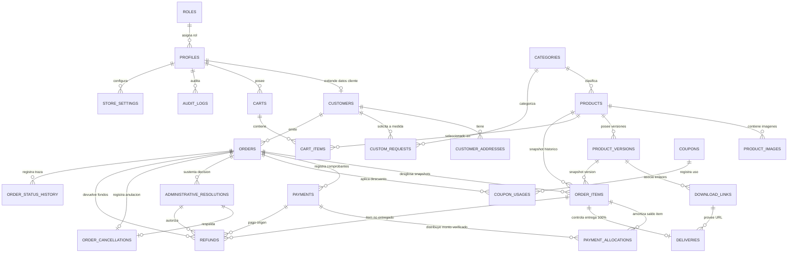

# Modelo Relacional de Base de Datos — SmartLab Store
**Motor:** PostgreSQL (Supabase)  
**Moneda Base:** Soles Peruanos (`PEN` / `S/`)  
**Ecosistema:** Supabase Auth, Storage, Funciones RPC y Row Level Security (RLS)

---

## 1. Principios de Diseño y Reglas de Negocio del Modelo

1. **Inmutabilidad y Preservación Histórica:**
   - La tabla de detalles de pedido (`order_items`) actúa como un snapshot inmutable. Almacena copia exacta del título del producto, versión adquirida, SKU/código, modalidad (`FREE`, `PRO`, `PERSONALIZADO`), precio regular unitario en `S/`, descuento unitario y precio final cobrado, independientemente de si el producto es editado, archivado o modificado en el catálogo posteriormente.
2. **Autenticación y Datos del Comprador (Correo Obligatorio y Único + Teléfono Obligatorio):**
   - La autenticación en Supabase Auth se realiza mediante **correo electrónico + contraseña** (con la verificación SMS desactivada inicialmente).
   - En `profiles`, **el correo electrónico (`email`) es obligatorio y único (`NOT NULL, UNIQUE`)** para crear una cuenta, y **el número de teléfono (`phone_number`) es obligatorio (`NOT NULL`)** para el checkout y contacto por WhatsApp.
   - En `orders`, se preservan como snapshots obligatorios tanto `buyer_email` (`NOT NULL`) como `buyer_phone` (`NOT NULL`).
3. **Soporte Multi-Producto, Registro Rápido y Creación en Checkout:**
   - Todo pedido (`orders`) se crea al finalizar el checkout (integrando el registro rápido de cuenta si el comprador era visitante) en estado `PENDIENTE_PAGO` y puede contener uno o múltiples productos (`order_items`).
4. **Pagos Manuales, Comprobantes en Revisión y Asignación por Producto:**
   - Los comprobantes en estado `PENDIENTE` (en revisión) **no confirman el pago** ni incrementan `orders.total_paid_amount` ni `order_items.allocated_paid_amount`.
   - Solo cuando el administrador verifica manualmente un pago (`verification_status = 'APROBADO'`), su importe verificado (`amount_verified`) se distribuye entre los productos del pedido mediante `payment_allocations`, prohibiendo cualquier sobreasignación.
5. **Pagos Parciales y Vencimiento Predeterminado de 72 Horas (Configurable) sin Alterar Saldos:**
   - Se permiten pagos parciales (`PAGO_PARCIAL`).
   - Los pedidos tienen un **vencimiento predeterminado de 72 horas** desde su creación (`expires_at`), configurable desde el panel administrativo mediante `store_settings` (`order_expiration_hours = 72`).
   - Al vencer un pedido (`order_status = 'VENCIDO'`), se aplican las reglas financieras y de asignación de pagos ya definidas, **sin eliminar pagos ni alterar saldos históricos** (`total_paid_amount` y `allocated_paid_amount` permanecen inalterables).
6. **Condición Estricta de Entrega al 100 % y Enlaces Iniciales vs. Futuros:**
   - Un producto (`order_items`) solo puede entregarse cuando está pagado al 100 % (`allocated_paid_amount = subtotal_price`, por lo que `is_fully_paid = true`).
   - La tabla `download_links` y la tabla `deliveries` soportan en la fase inicial enlaces permanentes de **Google Drive** y **MediaFire** enviados manualmente por WhatsApp (`sent_via_whatsapp_at`), e incluyen los campos (`access_token`, `token_expires_at`) preparados para la futura migración a almacenamiento privado con enlaces temporales.
7. **Trazabilidad de Cancelaciones, Resoluciones y Regla de No Reembolso:**
   - Una cancelación manual bloquea todas las entregas pendientes (`deliveries.is_enabled = false`, `item_delivery_status = 'REVOCADO'`) y exige un registro en `administrative_resolutions`.
   - **Un producto cuyo enlace ya fue enviado (`item_delivery_status = 'ENTREGADO'` o `deliveries.sent_at IS NOT NULL`) NO es reembolsable.**
   - Los productos no entregados pueden evaluarse para reembolso, el cual solo se considera completado cuando se registra la devolución efectiva del dinero en `refunds`.

---

## 2. Grupos de Tablas y Especificación Detallada

### Grupo 1: Usuarios, Perfiles y Roles
Articulado con el esquema nativo de autenticación de Supabase (`auth.users`).

#### 1.1. `roles`
Catálogo de roles del sistema.
- `id` (VARCHAR(30), PK): Identificador único del rol (`admin`, `customer`).
- `name` (VARCHAR(50), NOT NULL): Nombre legible del rol.
- `description` (TEXT): Alcance y permisos asociados.
- `created_at` (TIMESTAMPTZ, NOT NULL, DEFAULT now()).

#### 1.2. `profiles`
Información del usuario autenticado en Supabase (`correo + contraseña`, con verificación SMS desactivada inicialmente).
- `id` (UUID, PK, FK -> `auth.users.id` ON DELETE RESTRICT): Identificador del usuario.
- `role_id` (VARCHAR(30), NOT NULL, FK -> `roles.id` ON DELETE RESTRICT, DEFAULT 'customer').
- `email` (VARCHAR(255), NOT NULL, UNIQUE): Correo electrónico **obligatorio y único** para crear la cuenta.
- `full_name` (VARCHAR(150), NOT NULL): Nombre completo o razón social.
- `phone_number` (VARCHAR(25), NOT NULL): Número de teléfono/WhatsApp **obligatorio** para checkout y contacto por WhatsApp.
- `document_type` (VARCHAR(10), CHECK in ['DNI', 'RUC', 'CE', 'OTRO']): Tipo de documento de identidad (opcional).
- `document_number` (VARCHAR(20)): Número de documento de identidad (opcional).
- `is_active` (BOOLEAN, NOT NULL, DEFAULT true): Indicador de cuenta activa o suspendida.
- `created_at` (TIMESTAMPTZ, NOT NULL, DEFAULT now()).
- `updated_at` (TIMESTAMPTZ, NOT NULL, DEFAULT now()).
- **Índices:** `idx_profiles_role` (`role_id`), `idx_profiles_email` (`email`), `idx_profiles_phone` (`phone_number`).

---

### Grupo 2: Clientes, Direcciones y Solicitudes Personalizadas

#### 2.1. `customers`
Metadatos comerciales e históricos del cliente.
- `id` (UUID, PK, FK -> `profiles.id` ON DELETE RESTRICT).
- `billing_business_name` (VARCHAR(200)): Razón social o nombre para comprobante (opcional).
- `billing_document_type` (VARCHAR(10), CHECK in ['DNI', 'RUC']): Tipo de documento fiscal.
- `billing_document_number` (VARCHAR(20)): Número de RUC o DNI.
- `total_orders_count` (INTEGER, NOT NULL, DEFAULT 0, CHECK >= 0): Total de pedidos creados.
- `total_spent_amount` (NUMERIC(12,2), NOT NULL, DEFAULT 0.00, CHECK >= 0.00): Total acumulado de pagos verificados en `S/`.
- `created_at` (TIMESTAMPTZ, NOT NULL, DEFAULT now()).
- `updated_at` (TIMESTAMPTZ, NOT NULL, DEFAULT now()).

#### 2.2. `customer_addresses`
Direcciones opcionales registradas por el cliente para referencia comercial o facturación.
- `id` (UUID, PK, DEFAULT gen_random_uuid()).
- `customer_id` (UUID, NOT NULL, FK -> `customers.id` ON DELETE CASCADE).
- `address_type` (VARCHAR(20), NOT NULL, CHECK in ['BILLING', 'CONTACT']): Tipo de dirección.
- `department` (VARCHAR(50), NOT NULL): Departamento (ej. Lima, Arequipa).
- `province` (VARCHAR(50), NOT NULL): Provincia.
- `district` (VARCHAR(50), NOT NULL): Distrito.
- `street_address` (VARCHAR(255), NOT NULL): Dirección detallada.
- `reference` (VARCHAR(255)): Referencia adicional.
- `is_default` (BOOLEAN, NOT NULL, DEFAULT false).
- `created_at` (TIMESTAMPTZ, NOT NULL, DEFAULT now()).
- `updated_at` (TIMESTAMPTZ, NOT NULL, DEFAULT now()).
- **Índices:** `idx_customer_addresses_customer` (`customer_id`).

#### 2.3. `custom_requests`
Solicitudes de productos personalizados bajo pedido enviadas desde la tienda pública.
- `id` (UUID, PK, DEFAULT gen_random_uuid()).
- `customer_id` (UUID, NULL, FK -> `customers.id` ON DELETE SET NULL): Cliente autenticado (si aplica).
- `product_id` (UUID, NULL, FK -> `products.id` ON DELETE SET NULL): Producto base de referencia (si solicita adaptar uno existente).
- `category_id` (VARCHAR(50), NOT NULL, FK -> `categories.id` ON DELETE RESTRICT): Categoría requerida.
- `requester_name` (VARCHAR(150), NOT NULL): Nombre completo del solicitante.
- `requester_email` (VARCHAR(255), NOT NULL): Correo electrónico del solicitante.
- `requester_phone` (VARCHAR(25), NOT NULL): Teléfono / WhatsApp (**obligatorio**).
- `requirements_detail` (TEXT, NOT NULL): Descripción detallada de la herramienta o adaptación solicitada.
- `quoted_price` (NUMERIC(10,2), CHECK quoted_price IS NULL OR quoted_price >= 0.00): Monto cotizado en `S/` por el administrador.
- `status` (VARCHAR(30), NOT NULL, CHECK in ['RECIBIDO', 'EN_EVALUACION', 'COTIZADO', 'CONVERTIDO_A_PEDIDO', 'DESCARTADO'], DEFAULT 'RECIBIDO').
- `generated_order_id` (UUID, NULL, FK -> `orders.id` ON DELETE SET NULL): Pedido generado al aprobarse la cotización.
- `admin_notes` (TEXT): Notas internas del administrador.
- `created_at` (TIMESTAMPTZ, NOT NULL, DEFAULT now()).
- `updated_at` (TIMESTAMPTZ, NOT NULL, DEFAULT now()).
- **Índices:** `idx_custom_requests_status` (`status`), `idx_custom_requests_customer` (`customer_id`).

---

### Grupo 3: Categorías y Productos

#### 3.1. `categories`
Clasificación de productos según las seis líneas oficiales de negocio.
- `id` (VARCHAR(50), PK): Clave única (`excel`, `google_sheets`, `sistemas`, `android_apps`, `automatizaciones`, `recursos_digitales`).
- `name` (VARCHAR(100), NOT NULL, UNIQUE): Nombre visible de la categoría.
- `slug` (VARCHAR(100), NOT NULL, UNIQUE): Identificador para URL amigable.
- `description` (TEXT): Descripción general de la categoría.
- `icon_name` (VARCHAR(50)): Identificador del icono para el menú vertical estilo Techoze-04.
- `display_order` (SMALLINT, NOT NULL, DEFAULT 0): Orden en menús y pestañas.
- `is_active` (BOOLEAN, NOT NULL, DEFAULT true): Visibilidad pública.
- `created_at` (TIMESTAMPTZ, NOT NULL, DEFAULT now()).
- `updated_at` (TIMESTAMPTZ, NOT NULL, DEFAULT now()).

#### 3.2. `products`
Catálogo central de soluciones y herramientas digitales.
- `id` (UUID, PK, DEFAULT gen_random_uuid()).
- `category_id` (VARCHAR(50), NOT NULL, FK -> `categories.id` ON DELETE RESTRICT).
- `product_type` (VARCHAR(20), NOT NULL, CHECK in ['FREE', 'PRO', 'PERSONALIZADO']): Modalidad del producto.
- `title` (VARCHAR(200), NOT NULL): Nombre comercial del producto.
- `slug` (VARCHAR(220), NOT NULL, UNIQUE): Ruta URL única.
- `sku` (VARCHAR(50), NOT NULL, UNIQUE): Código interno de producto.
- `short_description` (VARCHAR(300), NOT NULL): Resumen para tarjetas y vista rápida.
- `full_description` (TEXT, NOT NULL): Descripción completa y beneficios.
- `features_list` (JSONB, NOT NULL, DEFAULT '[]'): Lista estructurada de características funcionales.
- `technical_requirements` (TEXT): Requisitos técnicos (ej. Excel 2019+, Android 10+).
- `regular_price` (NUMERIC(10,2), NOT NULL, DEFAULT 0.00, CHECK >= 0.00): Precio regular en Soles (`S/`).
- `is_on_promotion` (BOOLEAN, NOT NULL, DEFAULT false): Indicador de oferta activa.
- `promotional_price` (NUMERIC(10,2), CHECK promotional_price IS NULL OR promotional_price >= 0.00): Precio de oferta en Soles (`S/`).
- `promo_ends_at` (TIMESTAMPTZ, NULL): Fecha límite opcional para el contador regresivo (*Deal of the Day*).
- `is_featured` (BOOLEAN, NOT NULL, DEFAULT false): Destacado en página de inicio.
- `is_bestseller` (BOOLEAN, NOT NULL, DEFAULT false): Etiqueta de más vendido.
- `is_new` (BOOLEAN, NOT NULL, DEFAULT true): Etiqueta de novedad.
- `is_active` (BOOLEAN, NOT NULL, DEFAULT true): Producto visible en tienda pública (borrado lógico).
- `created_at` (TIMESTAMPTZ, NOT NULL, DEFAULT now()).
- `updated_at` (TIMESTAMPTZ, NOT NULL, DEFAULT now()).
- **Restricciones:**
  - `chk_products_free_price`: `(product_type = 'FREE' AND regular_price = 0.00 AND promotional_price IS NULL) OR (product_type != 'FREE')`
  - `chk_products_promo_less`: `promotional_price IS NULL OR promotional_price < regular_price`
- **Índices:** `idx_products_category` (`category_id`), `idx_products_type` (`product_type`), `idx_products_slug` (`slug`), `idx_products_active` (`is_active`).

---

### Grupo 4: Imágenes, Versiones y Enlaces de Descarga

#### 4.1. `product_images`
Galería gráfica almacenada en Supabase Storage (`public-assets`).
- `id` (UUID, PK, DEFAULT gen_random_uuid()).
- `product_id` (UUID, NOT NULL, FK -> `products.id` ON DELETE CASCADE).
- `storage_path` (VARCHAR(500), NOT NULL): Ruta en el bucket `public-assets`.
- `public_url` (VARCHAR(1000), NOT NULL): URL pública de la imagen.
- `alt_text` (VARCHAR(200)): Texto alternativo para accesibilidad.
- `display_order` (SMALLINT, NOT NULL, DEFAULT 0): Orden en la galería.
- `is_cover` (BOOLEAN, NOT NULL, DEFAULT false): Imagen principal de portada (proporción 1:1).
- `created_at` (TIMESTAMPTZ, NOT NULL, DEFAULT now()).
- **Índices:** `idx_product_images_product` (`product_id`).

#### 4.2. `product_versions`
Control de versiones publicadas de cada producto digital.
- `id` (UUID, PK, DEFAULT gen_random_uuid()).
- `product_id` (UUID, NOT NULL, FK -> `products.id` ON DELETE RESTRICT).
- `version_tag` (VARCHAR(30), NOT NULL): Etiqueta de versión (ej. `v1.0.0`, `v2.1`).
- `release_notes` (TEXT): Novedades o cambios de la versión.
- `is_current_version` (BOOLEAN, NOT NULL, DEFAULT true): Indica la versión vigente para nuevas compras.
- `created_at` (TIMESTAMPTZ, NOT NULL, DEFAULT now()).
- **Restricciones:** `UNIQUE(product_id, version_tag)`.
- **Índices:** `idx_product_versions_product` (`product_id`).

#### 4.3. `download_links`
Repositorio protegido de enlaces de descarga por versión. Soporta enlaces permanentes iniciales de **Google Drive** y **MediaFire**, y futura migración a almacenamiento privado (`PRIVATE_STORAGE`).
- `id` (UUID, PK, DEFAULT gen_random_uuid()).
- `product_version_id` (UUID, NOT NULL, FK -> `product_versions.id` ON DELETE RESTRICT).
- `provider` (VARCHAR(30), NOT NULL, CHECK in ['GOOGLE_DRIVE', 'MEDIAFIRE', 'PRIVATE_STORAGE']): Proveedor del archivo.
- `link_mode` (VARCHAR(20), NOT NULL, CHECK in ['PERMANENT_EXTERNAL', 'TEMPORARY_SIGNED'], DEFAULT 'PERMANENT_EXTERNAL'): Modo de enlace (inicialmente permanente en Drive/MediaFire; preparado para enlaces temporales firmados).
- `storage_url` (TEXT, NOT NULL): URL de Google Drive / MediaFire o ruta privada del objeto en almacenamiento privado.
- `file_format` (VARCHAR(20), NOT NULL): Extensión o tipo (`.xlsx`, `.xlsm`, `.zip`, `.apk`, `.pdf`, etc.).
- `file_size_bytes` (BIGINT, CHECK file_size_bytes IS NULL OR file_size_bytes > 0): Peso aproximado.
- `is_active` (BOOLEAN, NOT NULL, DEFAULT true): Estado del enlace.
- `instructions` (TEXT): Instrucciones de descarga o uso que se incluirán en el mensaje preparado de WhatsApp.
- `created_at` (TIMESTAMPTZ, NOT NULL, DEFAULT now()).
- `updated_at` (TIMESTAMPTZ, NOT NULL, DEFAULT now()).
- **Índices:** `idx_download_links_version` (`product_version_id`).

---

### Grupo 5: Carritos y Detalles

#### 5.1. `carts`
Contenedor temporal de compra para usuarios autenticados o visitantes.
- `id` (UUID, PK, DEFAULT gen_random_uuid()).
- `user_id` (UUID, FK -> `auth.users.id` ON DELETE CASCADE): Usuario autenticado (opcional en etapa de carrito).
- `session_token` (VARCHAR(120), UNIQUE): Token de sesión para visitante.
- `coupon_code` (VARCHAR(50)): Código de cupón aplicado.
- `discount_amount` (NUMERIC(10,2), NOT NULL, DEFAULT 0.00, CHECK >= 0.00): Descuento estimado en `S/`.
- `created_at` (TIMESTAMPTZ, NOT NULL, DEFAULT now()).
- `updated_at` (TIMESTAMPTZ, NOT NULL, DEFAULT now()).
- **Restricciones:** `CHECK(user_id IS NOT NULL OR session_token IS NOT NULL)`.
- **Índices:** `idx_carts_user` (`user_id`), `idx_carts_session` (`session_token`).

#### 5.2. `cart_items`
Detalle de productos seleccionados en el carrito.
- `id` (UUID, PK, DEFAULT gen_random_uuid()).
- `cart_id` (UUID, NOT NULL, FK -> `carts.id` ON DELETE CASCADE).
- `product_id` (UUID, NOT NULL, FK -> `products.id` ON DELETE CASCADE).
- `product_version_id` (UUID, NOT NULL, FK -> `product_versions.id` ON DELETE RESTRICT).
- `quantity` (SMALLINT, NOT NULL, DEFAULT 1, CHECK quantity = 1): Licencia individual por producto.
- `created_at` (TIMESTAMPTZ, NOT NULL, DEFAULT now()).
- **Restricciones:** `UNIQUE(cart_id, product_id)`.
- **Índices:** `idx_cart_items_cart` (`cart_id`).

---

### Grupo 6: Pedidos y Detalles (Snapshots Inmutables y Vencimientos)

#### 6.1. `orders`
Cabecera comercial del pedido, creada al finalizar el checkout. Conserva los datos del comprador (correo de su cuenta y teléfono obligatorio para WhatsApp), importes y saldos históricos incluso cuando el pedido vence.
- `id` (UUID, PK, DEFAULT gen_random_uuid()).
- `order_number` (VARCHAR(30), NOT NULL, UNIQUE): Código único legible (ej. `SL-2026-000123`).
- `customer_id` (UUID, NOT NULL, FK -> `customers.id` ON DELETE RESTRICT): Cuenta del cliente propietaria del pedido.
- `buyer_full_name` (VARCHAR(150), NOT NULL): Snapshot del nombre del comprador en el checkout.
- `buyer_email` (VARCHAR(255), NOT NULL): Snapshot del correo electrónico de la cuenta del comprador (**obligatorio**).
- `buyer_phone` (VARCHAR(25), NOT NULL): Snapshot del teléfono/WhatsApp del comprador (**obligatorio para checkout y contacto por WhatsApp**).
- `buyer_document_type` (VARCHAR(10), NULL, CHECK in ['DNI', 'RUC', 'CE', 'OTRO']): Tipo de documento (opcional).
- `buyer_document_number` (VARCHAR(20), NULL): Número de documento (opcional).
- `preferred_payment_method` (VARCHAR(30), NOT NULL, CHECK in ['YAPE', 'PLIN', 'TRANSFERENCIA_BANCARIA', 'GRATUITO']): Medio de pago elegido en el checkout.
- `order_status` (VARCHAR(30), NOT NULL, CHECK in [
    'PENDIENTE_PAGO',
    'PAGO_EN_REVISION',
    'PAGO_PARCIAL',
    'PAGO_VERIFICADO',
    'COMPLETADO',
    'VENCIDO',
    'OBSERVADO',
    'CANCELADO',
    'REEMBOLSADO'
  ], DEFAULT 'PENDIENTE_PAGO'): Estado general del pedido.
- `currency` (VARCHAR(3), NOT NULL, DEFAULT 'PEN', CHECK currency = 'PEN'): Moneda fija en Soles.
- `gross_amount` (NUMERIC(10,2), NOT NULL, CHECK >= 0.00): Suma de precios unitarios vigentes de los ítems en `S/`.
- `discount_amount` (NUMERIC(10,2), NOT NULL, DEFAULT 0.00, CHECK >= 0.00): Descuento por cupón aplicado al pedido.
- `net_amount` (NUMERIC(10,2), NOT NULL, CHECK >= 0.00): Monto total neto a pagar en `S/` (`gross_amount - discount_amount`).
- `total_paid_amount` (NUMERIC(10,2), NOT NULL, DEFAULT 0.00, CHECK >= 0.00): Suma exclusiva de pagos verificados (`APROBADO`) y asignados. **Nunca se elimina ni altera cuando el pedido pasa a `VENCIDO`**.
- `pending_balance_amount` (NUMERIC(10,2), NOT NULL, DEFAULT 0.00, CHECK >= 0.00): Saldo pendiente del pedido (`net_amount - total_paid_amount`).
- `customer_notes` (TEXT): Notas indicadas por el comprador en el checkout.
- `internal_notes` (TEXT): Notas internas del administrador.
- `placed_at` (TIMESTAMPTZ, NOT NULL, DEFAULT now()): Fecha y hora de creación en el checkout.
- `expires_at` (TIMESTAMPTZ, NOT NULL, DEFAULT (now() + interval '72 hours')): Fecha y hora de vencimiento del pedido (**72 horas predeterminadas**, calculadas según el valor configurable `order_expiration_hours` en `store_settings`).
- `expired_at` (TIMESTAMPTZ, NULL): Fecha y hora en que el pedido pasó al estado `VENCIDO` (conservando todos sus pagos y saldos históricos).
- `completed_at` (TIMESTAMPTZ, NULL): Fecha en que se entregaron todos los productos del pedido.
- `created_at` (TIMESTAMPTZ, NOT NULL, DEFAULT now()).
- `updated_at` (TIMESTAMPTZ, NOT NULL, DEFAULT now()).
- **Restricciones:**
  - `chk_orders_net_calc`: `net_amount = (gross_amount - discount_amount)`
  - `chk_orders_balance_calc`: `pending_balance_amount = GREATEST(net_amount - total_paid_amount, 0.00)`
- **Índices:** `idx_orders_customer` (`customer_id`), `idx_orders_status` (`order_status`), `idx_orders_number` (`order_number`), `idx_orders_placed` (`placed_at`).

#### 6.2. `order_items`
Detalle de productos por pedido con preservación histórica (Snapshot inmutable) y control individual de pago y entrega.
- `id` (UUID, PK, DEFAULT gen_random_uuid()).
- `order_id` (UUID, NOT NULL, FK -> `orders.id` ON DELETE RESTRICT).
- `product_id` (UUID, NOT NULL, FK -> `products.id` ON DELETE RESTRICT).
- `product_version_id` (UUID, NOT NULL, FK -> `product_versions.id` ON DELETE RESTRICT).
- `snapshot_product_title` (VARCHAR(200), NOT NULL): Nombre exacto del producto al momento de crear el pedido.
- `snapshot_sku` (VARCHAR(50), NOT NULL): SKU histórico del producto.
- `snapshot_product_type` (VARCHAR(20), NOT NULL, CHECK in ['FREE', 'PRO', 'PERSONALIZADO']).
- `snapshot_category_name` (VARCHAR(100), NOT NULL): Nombre histórico de la categoría.
- `snapshot_version_tag` (VARCHAR(30), NOT NULL): Versión exacta adquirida.
- `regular_unit_price` (NUMERIC(10,2), NOT NULL, CHECK >= 0.00): Precio regular histórico en `S/`.
- `discount_unit_amount` (NUMERIC(10,2), NOT NULL, DEFAULT 0.00, CHECK >= 0.00): Descuento unitario aplicado (promoción + prorrateo de cupón).
- `final_unit_price` (NUMERIC(10,2), NOT NULL, CHECK >= 0.00): Precio final unitario (`regular_unit_price - discount_unit_amount`).
- `quantity` (SMALLINT, NOT NULL, DEFAULT 1, CHECK quantity = 1): Licencia unitaria.
- `subtotal_price` (NUMERIC(10,2), NOT NULL, CHECK >= 0.00): Importe total neto requerido para este producto (`final_unit_price * quantity`).
- `allocated_paid_amount` (NUMERIC(10,2), NOT NULL, DEFAULT 0.00, CHECK >= 0.00): Suma de importes verificados asignados a este producto en `payment_allocations`. **Se conserva intacto aunque el pedido venza**.
- `pending_item_balance` (NUMERIC(10,2), NOT NULL, DEFAULT 0.00, CHECK >= 0.00): Saldo pendiente de este producto (`subtotal_price - allocated_paid_amount`).
- `is_fully_paid` (BOOLEAN, NOT NULL, DEFAULT false): `true` única y exclusivamente cuando `allocated_paid_amount = subtotal_price`.
- `item_payment_status` (VARCHAR(25), NOT NULL, CHECK in ['SIN_PAGO', 'PAGO_PARCIAL', 'PAGADO_100', 'REEMBOLSADO'], DEFAULT 'SIN_PAGO'): Estado de pago individual del producto.
- `item_delivery_status` (VARCHAR(25), NOT NULL, CHECK in ['PENDIENTE_PAGO', 'LISTO_PARA_ENTREGA', 'ENTREGADO', 'REVOCADO'], DEFAULT 'PENDIENTE_PAGO'): Estado de entrega individual del producto.
- `created_at` (TIMESTAMPTZ, NOT NULL, DEFAULT now()).
- `updated_at` (TIMESTAMPTZ, NOT NULL, DEFAULT now()).
- **Restricciones:**
  - `UNIQUE(order_id, product_id)`
  - `chk_order_items_no_overallocation`: `allocated_paid_amount <= subtotal_price`
  - `chk_order_items_fully_paid_match`: `(is_fully_paid = true AND allocated_paid_amount = subtotal_price) OR (is_fully_paid = false AND allocated_paid_amount < subtotal_price)`
  - `chk_order_items_delivery_requires_full_payment`: `(item_delivery_status IN ('LISTO_PARA_ENTREGA', 'ENTREGADO') AND is_fully_paid = true) OR (item_delivery_status IN ('PENDIENTE_PAGO', 'REVOCADO'))`
- **Índices:** `idx_order_items_order` (`order_id`), `idx_order_items_product` (`product_id`).

---

### Grupo 7: Pagos y Asignación de Pagos por Producto

#### 7.1. `payments`
Registro de pagos y comprobantes enviados manualmente por WhatsApp o subidos en la plataforma. **Los comprobantes en estado `PENDIENTE` (en revisión) no confirman el pago**.
- `id` (UUID, PK, DEFAULT gen_random_uuid()).
- `order_id` (UUID, NOT NULL, FK -> `orders.id` ON DELETE RESTRICT).
- `payment_method` (VARCHAR(30), NOT NULL, CHECK in ['YAPE', 'PLIN', 'TRANSFERENCIA_BANCARIA']): Método de pago utilizado.
- `submission_channel` (VARCHAR(20), NOT NULL, CHECK in ['WHATSAPP', 'WEB_PORTAL', 'ADMIN_DIRECT'], DEFAULT 'WHATSAPP'): Canal por el que se recibió el comprobante.
- `amount_reported` (NUMERIC(10,2), NOT NULL, CHECK > 0.00): Importe en Soles (`S/`) declarado por el cliente.
- `amount_verified` (NUMERIC(10,2), NULL, CHECK amount_verified IS NULL OR amount_verified >= 0.00): Importe real verificado por el administrador en cuenta/billetera. Solo se establece al aprobar el pago.
- `operation_number` (VARCHAR(80), NULL): Número de operación bancaria o de billetera.
- `operation_date` (TIMESTAMPTZ, NULL): Fecha/hora que figura en el comprobante.
- `receipt_storage_path` (VARCHAR(500), NULL): Ruta opcional de la imagen del comprobante en el bucket privado `payment-receipts` (puede ser adjuntada por el administrador tras recibirla por WhatsApp o subida por el cliente).
- `verification_status` (VARCHAR(25), NOT NULL, CHECK in ['PENDIENTE', 'APROBADO', 'OBSERVADO', 'RECHAZADO'], DEFAULT 'PENDIENTE'): Estado de verificación manual.
- `verified_by_user_id` (UUID, NULL, FK -> `profiles.id` ON DELETE RESTRICT): Administrador que verificó el pago.
- `verified_at` (TIMESTAMPTZ, NULL): Fecha y hora de verificación.
- `admin_notes` (TEXT, NULL): Observaciones o motivo de rechazo.
- `created_at` (TIMESTAMPTZ, NOT NULL, DEFAULT now()).
- `updated_at` (TIMESTAMPTZ, NOT NULL, DEFAULT now()).
- **Restricciones:**
  - `chk_payments_approved_fields`: `(verification_status = 'APROBADO' AND amount_verified IS NOT NULL AND amount_verified > 0.00 AND verified_by_user_id IS NOT NULL) OR (verification_status != 'APROBADO')`
- **Índices:** `idx_payments_order` (`order_id`), `idx_payments_status` (`verification_status`), `idx_payments_operation` (`operation_number`).

#### 7.2. `payment_allocations`
Asignación exacta del importe de un pago **aprobado** a uno o varios productos del pedido. Permite pagos parciales y distribuciones multi-producto sin sobreasignación.
- `id` (UUID, PK, DEFAULT gen_random_uuid()).
- `payment_id` (UUID, NOT NULL, FK -> `payments.id` ON DELETE RESTRICT): Debe referenciar un pago con `verification_status = 'APROBADO'`.
- `order_item_id` (UUID, NOT NULL, FK -> `order_items.id` ON DELETE RESTRICT): Producto del mismo pedido al que se asigna el importe.
- `allocated_amount` (NUMERIC(10,2), NOT NULL, CHECK > 0.00): Monto en Soles (`S/`) asignado a este producto específico.
- `allocated_by_user_id` (UUID, NOT NULL, FK -> `profiles.id` ON DELETE RESTRICT): Administrador que realizó la asignación.
- `is_reversed` (BOOLEAN, NOT NULL, DEFAULT false): Indica si la asignación fue revertida por un reembolso de producto no entregado.
- `reversed_at` (TIMESTAMPTZ, NULL): Fecha de reversión por reembolso.
- `created_at` (TIMESTAMPTZ, NOT NULL, DEFAULT now()).
- **Restricciones:**
  - `UNIQUE(payment_id, order_item_id)`
- **Índices:** `idx_allocations_payment` (`payment_id`), `idx_allocations_item` (`order_item_id`).

---

### Grupo 8: Entregas Digitales por Producto

#### 8.1. `deliveries`
Controla la entrega individual de cada producto cuando alcanza el 100 % de pago (`order_items.is_fully_paid = true`). Registra el envío manual por WhatsApp y soporta tanto enlaces iniciales de Drive/MediaFire como futuros enlaces temporales.
- `id` (UUID, PK, DEFAULT gen_random_uuid()).
- `order_item_id` (UUID, NOT NULL, UNIQUE, FK -> `order_items.id` ON DELETE RESTRICT): Un registro de entrega por cada producto del pedido.
- `download_link_id` (UUID, NULL, FK -> `download_links.id` ON DELETE RESTRICT): Enlace base de la versión del producto.
- `custom_download_url` (TEXT, NULL): Enlace individual específico (cuando se entrega una carpeta o archivo adaptado exclusivamente para ese pedido).
- `delivery_channel` (VARCHAR(30), NOT NULL, CHECK in ['WHATSAPP_MANUAL', 'WEB_PORTAL', 'WHATSAPP_AND_WEB'], DEFAULT 'WHATSAPP_MANUAL'): Canal de entrega utilizado.
- `is_enabled` (BOOLEAN, NOT NULL, DEFAULT false): Indica si el enlace está autorizado para el cliente. **Solo puede ser `true` si `order_items.is_fully_paid = true`**.
- `sent_at` (TIMESTAMPTZ, NULL): Fecha y hora en que el administrador envió el enlace al cliente (hito que convierte al producto en **no reembolsable**).
- `sent_by_user_id` (UUID, NULL, FK -> `profiles.id` ON DELETE RESTRICT): Administrador que realizó el envío del enlace por WhatsApp.
- `whatsapp_message_snapshot` (TEXT, NULL): Copia del mensaje preparado de WhatsApp enviado al cliente para trazabilidad.
- `access_token` (VARCHAR(100), NULL, UNIQUE): Token criptográfico opcional preparado para la futura migración a enlaces temporales firmados.
- `token_expires_at` (TIMESTAMPTZ, NULL): Fecha de expiración del enlace temporal (para futura migración).
- `download_count` (INTEGER, NOT NULL, DEFAULT 0, CHECK >= 0): Contador de clics desde el portal web (informativo).
- `last_downloaded_at` (TIMESTAMPTZ, NULL): Último acceso registrado desde el portal web.
- `revoked_at` (TIMESTAMPTZ, NULL): Fecha de bloqueo/revocación en caso de cancelación de entregas pendientes.
- `revocation_reason` (TEXT, NULL): Motivo de revocación.
- `created_at` (TIMESTAMPTZ, NOT NULL, DEFAULT now()).
- `updated_at` (TIMESTAMPTZ, NOT NULL, DEFAULT now()).
- **Restricciones:**
  - `chk_deliveries_has_url`: `download_link_id IS NOT NULL OR custom_download_url IS NOT NULL`
- **Índices:** `idx_deliveries_item` (`order_item_id`), `idx_deliveries_token` (`access_token`).

---

### Grupo 9: Cupones y Promociones

#### 9.1. `coupons`
Códigos de descuento aplicables en el carrito.
- `id` (UUID, PK, DEFAULT gen_random_uuid()).
- `code` (VARCHAR(50), NOT NULL, UNIQUE): Código alfanumérico en mayúsculas.
- `discount_type` (VARCHAR(20), NOT NULL, CHECK in ['PERCENTAGE', 'FIXED_AMOUNT']): Porcentaje o monto fijo en `S/`.
- `discount_value` (NUMERIC(10,2), NOT NULL, CHECK discount_value > 0.00): Valor del descuento.
- `minimum_order_amount` (NUMERIC(10,2), NOT NULL, DEFAULT 0.00, CHECK >= 0.00): Compra mínima requerida en `S/`.
- `max_discount_limit` (NUMERIC(10,2), NULL, CHECK max_discount_limit IS NULL OR max_discount_limit > 0.00): Tope máximo de descuento en `S/`.
- `starts_at` (TIMESTAMPTZ, NOT NULL): Inicio de vigencia.
- `expires_at` (TIMESTAMPTZ, NULL): Fin de vigencia.
- `max_usage_limit` (INTEGER, NULL, CHECK max_usage_limit IS NULL OR max_usage_limit > 0): Límite global de usos.
- `usage_count` (INTEGER, NOT NULL, DEFAULT 0, CHECK >= 0): Usos acumulados.
- `is_active` (BOOLEAN, NOT NULL, DEFAULT true).
- `created_at` (TIMESTAMPTZ, NOT NULL, DEFAULT now()).
- `updated_at` (TIMESTAMPTZ, NOT NULL, DEFAULT now()).
- **Restricciones:** `chk_coupon_percentage_limit`: `discount_type != 'PERCENTAGE' OR (discount_value > 0 AND discount_value <= 100)`.
- **Índices:** `idx_coupons_code` (`code`), `idx_coupons_active` (`is_active`).

#### 9.2. `coupon_usages`
Registro de uso de cupones por pedido y cliente.
- `id` (UUID, PK, DEFAULT gen_random_uuid()).
- `coupon_id` (UUID, NOT NULL, FK -> `coupons.id` ON DELETE RESTRICT).
- `order_id` (UUID, NOT NULL, FK -> `orders.id` ON DELETE RESTRICT).
- `customer_id` (UUID, NOT NULL, FK -> `customers.id` ON DELETE RESTRICT).
- `discount_applied_amount` (NUMERIC(10,2), NOT NULL, CHECK >= 0.00).
- `used_at` (TIMESTAMPTZ, NOT NULL, DEFAULT now()).
- **Restricciones:** `UNIQUE(coupon_id, order_id)`.
- **Índices:** `idx_coupon_usages_customer` (`customer_id`, `coupon_id`).

---

### Grupo 10: Cancelaciones, Resoluciones Administrativas y Reembolsos

#### 10.1. `administrative_resolutions`
Dictámenes administrativos obligatorios para cancelaciones manuales, evaluación de reembolsos, ajustes en pedidos vencidos o incidencias.
- `id` (UUID, PK, DEFAULT gen_random_uuid()).
- `order_id` (UUID, NOT NULL, FK -> `orders.id` ON DELETE RESTRICT).
- `admin_user_id` (UUID, NOT NULL, FK -> `profiles.id` ON DELETE RESTRICT): Administrador que emite la resolución.
- `resolution_type` (VARCHAR(40), NOT NULL, CHECK in [
    'CANCELACION_MANUAL',
    'EVALUACION_REEMBOLSO',
    'REACTIVACION_PEDIDO_VENCIDO',
    'REASIGNACION_ENLACE',
    'REVOCACION_ENTREGA_PENDIENTE',
    'RESOLUCION_OBSERVACION'
  ]).
- `decision_summary` (VARCHAR(250), NOT NULL): Resumen de la decisión tomada.
- `notes` (TEXT, NOT NULL): Sustento detallado de la resolución.
- `resolved_at` (TIMESTAMPTZ, NOT NULL, DEFAULT now()).
- **Índices:** `idx_resolutions_order` (`order_id`).

#### 10.2. `order_cancellations`
Registro formal de cancelación de un pedido. Toda cancelación manual bloquea entregas pendientes y referencia su resolución administrativa.
- `id` (UUID, PK, DEFAULT gen_random_uuid()).
- `order_id` (UUID, NOT NULL, UNIQUE, FK -> `orders.id` ON DELETE RESTRICT).
- `resolution_id` (UUID, NOT NULL, FK -> `administrative_resolutions.id` ON DELETE RESTRICT): Resolución administrativa obligatoria que respalda la cancelación.
- `cancelled_by_user_id` (UUID, NOT NULL, FK -> `profiles.id` ON DELETE RESTRICT): Administrador que ejecuta la cancelación.
- `cancellation_reason` (TEXT, NOT NULL): Motivo detallado de la cancelación.
- `cancellation_type` (VARCHAR(30), NOT NULL, CHECK in ['CLIENTE_SOLICITUD', 'COMPROBANTE_INVALIDO', 'ACUERDO_ADMINISTRATIVO', 'OTRO']).
- `pending_deliveries_blocked` (BOOLEAN, NOT NULL, DEFAULT true, CHECK pending_deliveries_blocked = true): Confirma el bloqueo de todas las entregas pendientes.
- `cancelled_at` (TIMESTAMPTZ, NOT NULL, DEFAULT now()).

#### 10.3. `refunds`
Registro de reembolsos para **productos cuyos enlaces NO fueron enviados**. Un reembolso solo pasa a `COMPLETADO` cuando se registra la devolución efectiva del dinero.
- `id` (UUID, PK, DEFAULT gen_random_uuid()).
- `order_id` (UUID, NOT NULL, FK -> `orders.id` ON DELETE RESTRICT).
- `order_item_id` (UUID, NOT NULL, FK -> `order_items.id` ON DELETE RESTRICT): Producto no entregado sobre el cual se reembolsa el saldo pagado.
- `payment_id` (UUID, NOT NULL, FK -> `payments.id` ON DELETE RESTRICT): Pago verificado de origen.
- `resolution_id` (UUID, NOT NULL, FK -> `administrative_resolutions.id` ON DELETE RESTRICT): Resolución administrativa que aprueba la devolución.
- `refund_status` (VARCHAR(25), NOT NULL, CHECK in ['EN_EVALUACION', 'APROBADO_PENDIENTE_DEVOLUCION', 'COMPLETADO', 'RECHAZADO'], DEFAULT 'EN_EVALUACION').
- `refund_amount` (NUMERIC(10,2), NOT NULL, CHECK > 0.00): Monto a devolver / devuelto en Soles (`S/`).
- `refund_method` (VARCHAR(30), NULL, CHECK in ['YAPE', 'PLIN', 'TRANSFERENCIA_BANCARIA']): Medio empleado para devolver el dinero.
- `destination_account` (VARCHAR(100), NULL): Número de celular o cuenta bancaria receptora del cliente.
- `destination_holder_name` (VARCHAR(150), NULL): Nombre del titular receptor.
- `operation_reference` (VARCHAR(100), NULL): Número de operación de la transferencia efectiva de devolución.
- `receipt_storage_path` (VARCHAR(500), NULL): Ruta del comprobante de devolución en el bucket privado `payment-receipts`.
- `processed_by_user_id` (UUID, NULL, FK -> `profiles.id` ON DELETE RESTRICT): Administrador que ejecutó la devolución.
- `reason` (TEXT, NOT NULL): Motivo del reembolso.
- `refunded_at` (TIMESTAMPTZ, NULL): Fecha y hora efectiva de la transferencia de devolución.
- `created_at` (TIMESTAMPTZ, NOT NULL, DEFAULT now()).
- `updated_at` (TIMESTAMPTZ, NOT NULL, DEFAULT now()).
- **Restricciones:**
  - `chk_refund_completed_requires_proof`: `(refund_status = 'COMPLETADO' AND refund_method IS NOT NULL AND destination_account IS NOT NULL AND operation_reference IS NOT NULL AND refunded_at IS NOT NULL) OR (refund_status != 'COMPLETADO')`
- **Índices:** `idx_refunds_order` (`order_id`), `idx_refunds_item` (`order_item_id`), `idx_refunds_status` (`refund_status`).

---

### Grupo 11: Configuración General, Historial de Estados y Auditoría

#### 11.1. `store_settings`
Parámetros globales configurables desde el panel administrativo (cuentas bancarias, números y QR de Yape/Plin, WhatsApp oficial, plazo de vencimiento de pedidos predeterminado en **72 horas** mediante `order_expiration_hours = 72`, banners y FAQs).
- `key` (VARCHAR(80), PK): Clave de configuración (ej. `whatsapp_official_number`, `payment_methods_config`, `order_expiration_hours` con valor inicial `72`, `home_banners`, `faq_items`).
- `value` (JSONB, NOT NULL): Valor estructurado de la configuración.
- `is_public` (BOOLEAN, NOT NULL, DEFAULT true): Indica si el parámetro puede ser leído por la tienda pública.
- `updated_by_user_id` (UUID, NULL, FK -> `profiles.id` ON DELETE SET NULL).
- `updated_at` (TIMESTAMPTZ, NOT NULL, DEFAULT now()).

#### 11.2. `order_status_history`
Línea de tiempo inmutable de cambios de estado de cada pedido.
- `id` (UUID, PK, DEFAULT gen_random_uuid()).
- `order_id` (UUID, NOT NULL, FK -> `orders.id` ON DELETE RESTRICT).
- `previous_status` (VARCHAR(30), NULL): Estado anterior.
- `new_status` (VARCHAR(30), NOT NULL): Nuevo estado del pedido.
- `changed_by_user_id` (UUID, NULL, FK -> `profiles.id` ON DELETE SET NULL): Usuario o administrador que ejecutó el cambio.
- `comment` (TEXT, NULL): Detalle o motivo de la transición.
- `created_at` (TIMESTAMPTZ, NOT NULL, DEFAULT now()).
- **Índices:** `idx_status_history_order` (`order_id`).

#### 11.3. `audit_logs`
Bitácora general inmutable sobre operaciones administrativas y financieras críticas.
- `id` (UUID, PK, DEFAULT gen_random_uuid()).
- `user_id` (UUID, NULL, FK -> `profiles.id` ON DELETE SET NULL): Usuario actor.
- `entity_type` (VARCHAR(50), NOT NULL): Entidad afectada (`PRODUCT`, `ORDER`, `PAYMENT`, `ALLOCATION`, `DELIVERY`, `CANCELLATION`, `RESOLUTION`, `REFUND`, `COUPON`, `CONFIG`).
- `entity_id` (VARCHAR(64), NOT NULL): Identificador del registro afectado.
- `action` (VARCHAR(30), NOT NULL, CHECK in ['INSERT', 'UPDATE', 'DELETE', 'VERIFY_PAYMENT', 'ALLOCATE_PAYMENT', 'SEND_LINK_WHATSAPP', 'REVOKE_DELIVERY', 'CANCEL_ORDER', 'COMPLETE_REFUND']).
- `old_data` (JSONB, NULL): Estado previo del registro.
- `new_data` (JSONB, NULL): Estado posterior al cambio.
- `ip_address` (VARCHAR(45), NULL): Dirección IP cuando esté disponible.
- `user_agent` (TEXT, NULL): Agente de navegador.
- `created_at` (TIMESTAMPTZ, NOT NULL, DEFAULT now()).
- **Índices:** `idx_audit_logs_entity` (`entity_type`, `entity_id`), `idx_audit_logs_user` (`user_id`), `idx_audit_logs_created` (`created_at`).

---

## 3. Diagrama de Relaciones Entidad-Relación (Mermaid)



---

## 4. Políticas de Seguridad por Fila (Row Level Security - RLS)

En Supabase, RLS garantiza que las consultas desde el navegador respeten los límites de acceso. Se define la función auxiliar en el esquema público `public.is_admin()` (`SECURITY DEFINER`, `SET search_path = public`) que verifica si existe un registro en `public.profiles` con `id = auth.uid()`, `upper(trim(role_id)) = 'ADMIN'` e `is_active = true`.

### 4.1. Catálogo y Configuración Pública (`categories`, `products`, `product_images`, `product_versions`, `store_settings`)
- **Visitantes y Clientes:**
  - `SELECT`: Permitido para registros con `is_active = true` (y `store_settings` con `is_public = true`).
  - `INSERT / UPDATE / DELETE`: Denegado en su totalidad.
- **Administradores (`public.is_admin() = true`):**
  - `ALL`: Control total sobre todos los registros.

### 4.2. Repositorio de Enlaces Descargables (`download_links`)
- **Visitantes y Clientes:**
  - `SELECT`: Permitido a un cliente autenticado **únicamente** si existe un registro en `deliveries` vinculado a una compra propia donde `order_items.is_fully_paid = true`, `deliveries.is_enabled = true` y `deliveries.revoked_at IS NULL` (o para productos `FREE` activos). En cualquier otro caso, denegado en su totalidad.
  - `INSERT / UPDATE / DELETE`: Denegado en su totalidad.
- **Administradores:**
  - `ALL`: Control total para gestionar enlaces de Google Drive, MediaFire o almacenamiento privado.

### 4.3. Carritos, Perfiles y Solicitudes Personalizadas (`carts`, `cart_items`, `profiles`, `customers`, `custom_requests`)
- **Clientes Autenticados:**
  - `profiles` y `customers`: `SELECT` y `UPDATE` únicamente sobre su propio registro (`id = auth.uid()`), sin permiso para alterar `role_id`, `is_active` ni `email` (doblemente blindado mediante RLS `WITH CHECK` y el trigger `trg_prevent_profile_role_escalation`).
  - `carts` y `cart_items`: `ALL` sobre su propio carrito (`user_id = auth.uid()`).
  - `custom_requests`: `INSERT` permitido; `SELECT` solo de sus propias solicitudes (`customer_id = auth.uid()`).
- **Administradores:**
  - `ALL`: Gestión completa de clientes y solicitudes personalizadas.

### 4.4. Pedidos y Detalles (`orders`, `order_items`)
- **Clientes Registrados:**
  - `SELECT`: Permitido exclusivamente si `orders.customer_id = auth.uid()`.
  - `INSERT`: Se realiza a través de la función transaccional `public.create_checkout_order(...)` que verifica que `customer_id = auth.uid()`, toma los precios reales vigentes en `products`, crea el pedido en `PENDIENTE_PAGO` y genera los snapshots en `order_items`.
  - `UPDATE / DELETE`: Prohibido para clientes modificar estados, importes o saldos directamente.
- **Administradores:**
  - `ALL`: Lectura completa y gestión de estados, vencimientos y notas internas.

### 4.5. Pagos y Asignaciones (`payments`, `payment_allocations`)
- **Clientes Registrados:**
  - `SELECT`: Visualización de pagos y asignaciones pertenecientes a sus propios pedidos (`orders.customer_id = auth.uid()`).
  - `INSERT`: En `payments`, permitido registrar un comprobante sobre un pedido propio con `verification_status = 'PENDIENTE'` y `amount_verified = NULL`. En `payment_allocations`, **denegado en su totalidad a clientes**.
  - `UPDATE / DELETE`: Prohibido para clientes.
- **Administradores:**
  - `ALL`: Verificación manual de comprobantes y asignación de importes por producto en `payment_allocations`.

### 4.6. Entregas Digitales (`deliveries`)
- **Clientes Registrados:**
  - `SELECT`: Permitido **únicamente** si se cumplen tres condiciones simultáneas:
    1. El pedido pertenece al cliente (`orders.customer_id = auth.uid()`).
    2. El producto específico está pagado al 100 % (`order_items.is_fully_paid = true`).
    3. La entrega fue habilitada/enviada y no está revocada (`deliveries.is_enabled = true AND deliveries.revoked_at IS NULL`).
  - `INSERT / UPDATE / DELETE`: Denegado en su totalidad a clientes.
- **Administradores:**
  - `ALL`: Habilitación de entregas de ítems pagados al 100 %, registro de envío por WhatsApp y revocación de entregas pendientes.

### 4.7. Cancelaciones, Resoluciones, Reembolsos y Auditoría (`order_cancellations`, `administrative_resolutions`, `refunds`, `order_status_history`, `audit_logs`)
- **Clientes Registrados:**
  - `SELECT`: Lectura de `order_cancellations`, `refunds` y `order_status_history` exclusivamente de sus propios pedidos.
  - `administrative_resolutions` y `audit_logs`: Denegado a clientes (`USING (false)`).
  - `INSERT / UPDATE / DELETE`: Denegado a clientes.
- **Administradores:**
  - `ALL`: Registro de resoluciones, cancelaciones, reembolsos efectivos y lectura de auditoría.

---

## 5. Triggers y Funciones de Integridad en PostgreSQL

1. **Trigger de No Sobreasignación y Cálculo de Saldos (`trg_payment_allocations_integrity`):**
   - Antes de insertar o actualizar en `payment_allocations`, verifica que:
     - El pago referenciado tenga `verification_status = 'APROBADO'`.
     - La suma asignada del pago no exceda `payments.amount_verified`.
     - La suma asignada al producto no exceda `order_items.subtotal_price`.
   - Recalcula automáticamente `order_items.allocated_paid_amount`, `order_items.pending_item_balance`, `order_items.is_fully_paid` (`allocated_paid_amount = subtotal_price`), `orders.total_paid_amount` y `orders.pending_balance_amount`.
   - Cuando `is_fully_paid` pasa a `true`, cambia `item_delivery_status` a `'LISTO_PARA_ENTREGA'` (sin marcarlo como `'ENTREGADO'` hasta que el administrador envíe el enlace por WhatsApp).
2. **Trigger de Bloqueo de Reembolso en Productos Entregados (`trg_prevent_delivered_refund`):**
   - Antes de insertar o actualizar en `refunds`, verifica el estado del `order_item_id`. Si `order_items.item_delivery_status = 'ENTREGADO'` o existe un registro en `deliveries` con `sent_at IS NOT NULL`, lanza una excepción de base de datos rechazando el reembolso: *"Un producto cuyo enlace ya fue enviado no es reembolsable"*.
3. **Trigger de Preservación de Saldos en Pedidos Vencidos (`trg_preserve_expired_balances`):**
   - Cuando `orders.order_status` cambia a `'VENCIDO'`, impide cualquier reducción o alteración de `orders.total_paid_amount`, `order_items.allocated_paid_amount` y `payment_allocations`.
4. **Trigger de Cancelación Manual y Bloqueo de Entregas Pendientes (`trg_order_cancellation_block`):**
   - Al insertar en `order_cancellations`, exige un `resolution_id` válido, cambia a `'REVOCADO'` todos los `order_items` cuya entrega aún estaba pendiente y deshabilita (`is_enabled = false`, `revoked_at = now()`) cualquier registro pendiente en `deliveries`.
5. **Trigger de Creación Automática de Perfil de Cliente (`trg_on_auth_user_created` — Endurecido en Migración 005):**
   - Se dispara `AFTER INSERT ON auth.users`. Crea automáticamente el registro en `public.profiles` y `public.customers` asignando siempre `role_id = 'customer'`, ignorando cualquier atributo `role`, `role_id` o `is_admin` enviado en `raw_user_meta_data`.
6. **Trigger de Blindaje contra Autoasignación o Escalamiento de Rol (`trg_prevent_profile_role_escalation` — Migración 005, Corrección Retroactiva Sprint 03):**
   - Se dispara `BEFORE INSERT OR UPDATE ON public.profiles`.
   - En `INSERT` desde una sesión de cliente, fuerza `NEW.role_id := 'customer'` y `NEW.is_active := true`.
   - En `UPDATE` desde una sesión de usuario que no sea administrador activo (`NOT public.is_admin()`), lanza una excepción si se intenta modificar `role_id`, `is_active` o `email`.
   - Permite cambios de rol únicamente cuando se ejecutan desde el entorno privilegiado del servidor (Supabase SQL Editor donde `auth.uid() IS NULL` y `current_user IN ('postgres', 'supabase_admin', 'service_role')`) o por un administrador activo (`public.is_admin() = true`).
7. **Función de Promoción Controlada del Primer Administrador (`public.promote_user_to_admin(p_email TEXT)` — Migración 005):**
   - Función `SECURITY DEFINER` cuyos permisos `EXECUTE` están revocados para `PUBLIC`, `anon` y `authenticated`.
   - Permite promover de forma segura y auditada (registrando el evento en `public.audit_logs`) a un usuario previamente registrado en Supabase Auth hacia `role_id = 'admin'` e `is_active = true` ejecutando en el **SQL Editor de Supabase**:
     ```sql
     SELECT public.promote_user_to_admin('admin@smartlab.pe');
     ```
