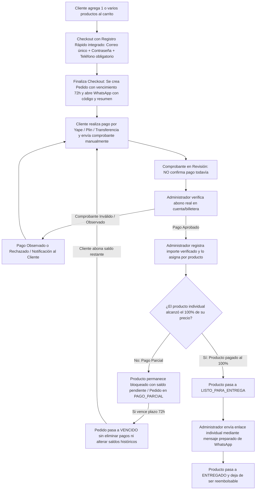
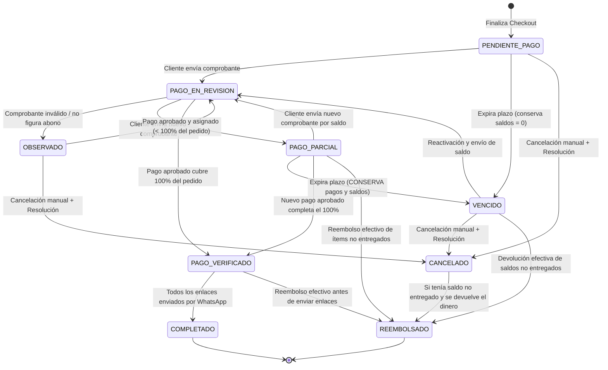
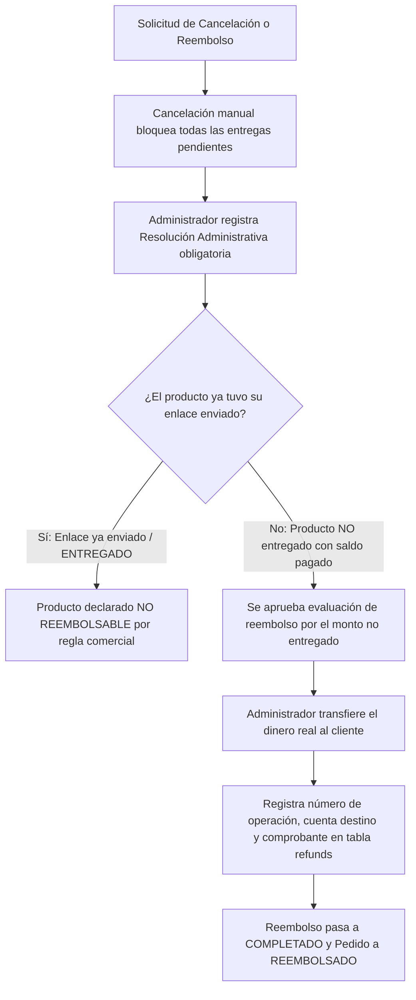

# Flujos Comerciales, Pedidos, Pagos y Entregas — SmartLab Store

**Moneda de Operación:** Soles Peruanos (`PEN` / `S/`)  
**Métodos de Pago:** Yape, Plin y Transferencia Bancaria  
**Canal Operativo de Comprobantes y Entrega Inicial:** WhatsApp (mensajes preparados) y Portal Web  
**Documentos Base de Referencia:** `01_VISION_PROYECTO.md`, `02_REQUERIMIENTOS.md`, `03_ARQUITECTURA.md`, `04_BASE_DATOS.md`

---

## 1. Visión General del Ciclo Comercial

El flujo comercial de SmartLab Store está diseñado para ofrecer una experiencia transparente, segura y adaptada al mercado peruano. Respeta estrictamente el ciclo operativo desde la creación del pedido al finalizar el checkout, la apertura automática de WhatsApp con el resumen del pedido, el envío manual del comprobante por el cliente, la verificación administrativa con asignación de importes por producto, el soporte de pagos parciales y vencimientos conservando saldos, hasta la entrega manual por WhatsApp exclusivamente cuando el producto está pagado al 100 %.

---

## 2. Etapas Detalladas de los Flujos Comerciales

### 2.1. Compra de Uno o Varios Productos
1. El usuario explora el catálogo organizado en las seis categorías oficiales (**Excel**, **Google Sheets**, **Sistemas**, **Aplicaciones Android**, **Automatizaciones**, **Recursos Digitales**).
2. El cliente puede agregar uno o varios productos al carrito:
   - Cada producto se añade como licencia unitaria (`quantity = 1`).
   - Si aplica un cupón válido, el sistema calcula el descuento y el importe neto de cada producto en Soles (`S/`).

### 2.2. Finalización del Checkout (con Registro Rápido), Creación del Pedido y Apertura de WhatsApp
1. En la pantalla de Checkout, el comprador se identifica o crea su cuenta mediante el **registro rápido integrado en el checkout**:
   - **Correo electrónico:** **Obligatorio y único** para crear la cuenta (autenticación mediante correo electrónico + contraseña).
   - **Contraseña:** Obligatoria si es un cliente nuevo que se registra en el checkout (permitiéndole luego **consultar sus pedidos y estados desde su cuenta**).
   - **Nombre completo:** Obligatorio.
   - **Teléfono / WhatsApp:** **Obligatorio** para el checkout y el contacto por WhatsApp (con la verificación SMS desactivada inicialmente).
   - **Documento (DNI/RUC):** Opcional.
2. El comprador selecciona el método de pago con el que realizará el abono (**Yape**, **Plin** o **Transferencia bancaria**) y visualiza en pantalla las cuentas, números y códigos QR oficiales de SmartLab Store.
3. **Regla de creación y vencimiento del pedido:** **El pedido se crea al finalizar el checkout.** En ese instante:
   - Se inserta el registro en `orders` vinculado a la cuenta del cliente (`customer_id`), con estado inicial `PENDIENTE_PAGO`, código único (ej. `SL-2026-000452`), fecha de creación (`placed_at`) y fecha de vencimiento (`expires_at`) calculada con el **plazo predeterminado de 72 horas** (configurable desde el panel administrativo en `store_settings`).
   - Se insertan los productos en `order_items` guardando sus **snapshots históricos** (nombre, versión, SKU, categoría y precio en `S/`), con `allocated_paid_amount = S/ 0.00`, `is_fully_paid = false`, `item_payment_status = 'SIN_PAGO'` e `item_delivery_status = 'PENDIENTE_PAGO'`.
4. **Apertura de WhatsApp con código y resumen:** Inmediatamente al finalizar el checkout y crearse el pedido, el sistema abre WhatsApp hacia el número oficial de SmartLab Store con un mensaje preparado:
   > *"Hola SmartLab Store, acabo de registrar mi pedido **SL-2026-000452**.*
   > *• Comprador: [Nombre] ([Teléfono] | [Correo])*
   > *• Productos: [Lista de productos y versiones]*
   > *• Total a pagar: **S/ [Monto Neto]***
   > *• Medio de pago elegido: **[Yape / Plin / Transferencia]***
   > *A continuación envío mi comprobante de pago para verificación."*

### 2.3. Envío Manual del Comprobante y Estado en Revisión
1. El cliente realiza la transferencia o pago desde su aplicación móvil y **envía el comprobante manualmente por WhatsApp** en el chat abierto (y opcionalmente puede subir la captura en el detalle de su pedido dentro de su cuenta web).
2. Cuando el comprobante es recibido o registrado como `PENDIENTE` de verificación, el pedido pasa a `PAGO_EN_REVISION`.
3. **Regla obligatoria:** **Los comprobantes en revisión no confirman el pago.** Mientras el pago esté en estado `PENDIENTE` (en revisión), el monto pagado del pedido (`total_paid_amount`) y el monto asignado a los productos (`allocated_paid_amount`) no se incrementan, y ningún enlace de descarga puede habilitarse.

### 2.4. Verificación Manual de Pagos (Yape, Plin y Transferencia)
1. El administrador revisa el comprobante recibido por WhatsApp (o subido en el portal) desde el módulo `/admin/payments`.
2. Contrasta los datos de la imagen con los movimientos reales de la cuenta bancaria o billetera Yape/Plin de SmartLab Store:
   - Importe real abonado en Soles (`S/`).
   - Fecha, hora, titular remitente y número de operación.
3. Resultado de la verificación:
   - **Aprobado (`APROBADO`):** El administrador confirma el ingreso efectivo del dinero, registra el `amount_verified` exacto y adjunta o conserva la captura en el bucket privado `payment-receipts`.
   - **Observado (`OBSERVADO`) o Rechazado (`RECHAZADO`):** Si el abono no figura en cuenta, el monto no coincide o el comprobante es inválido, el pago no se aprueba, se anota la observación y se informa al cliente por WhatsApp.

### 2.5. Registro de Pagos y Asignación por Producto
Una vez aprobado el pago (`verification_status = 'APROBADO'`), el administrador asigna el importe verificado entre los productos del pedido (`payment_allocations`):

1. **Prohibición de sobreasignación:**
   - La suma de los montos asignados desde un pago nunca puede superar el monto verificado de dicho pago:
     $$\sum \text{allocated\_amount} \le \text{payments.amount\_verified}$$
   - El monto acumulado asignado a un producto nunca puede superar su precio neto (`subtotal_price`):
     $$\text{order\_items.allocated\_paid\_amount} \le \text{order\_items.subtotal\_price}$$
2. **Distribución flexible:**
   - En un pago por el 100 % del pedido, el sistema asigna a cada producto su `subtotal_price` completo.
   - En un **pago parcial**, el administrador asigna el monto verificado a los productos indicados por el cliente o por orden de prioridad hasta agotar el importe abonado.

### 2.6. Pagos Parciales, Saldos Pendientes y Vencimiento de Pedidos
1. **Pagos parciales:**
   - Si el total de pagos verificados es menor al total neto del pedido (`total_paid_amount < net_amount`), el pedido se coloca en estado `PAGO_PARCIAL`.
   - Cada producto dentro del pedido muestra su propio estado de pago (`SIN_PAGO`, `PAGO_PARCIAL` o `PAGADO_100`) y su saldo pendiente exacto (`pending_item_balance`).
2. **Pedidos vencidos (72 horas predeterminadas, configurable) y conservación de saldos:**
   - Todo pedido tiene un vencimiento predeterminado de **72 horas**, configurable desde el panel administrativo.
   - Si vence el plazo de pago establecido sin haberse completado el total del pedido, el pedido pasa al estado `VENCIDO`.
   - **Regla inquebrantable:** **Al vencer un pedido, se aplican las reglas financieras y de asignación de pagos ya definidas, sin eliminar pagos ni alterar saldos históricos.** Ningún pago aprobado (`payments`) ni asignación por producto (`payment_allocations`, `allocated_paid_amount`) se pierde ni se reinicia a cero por vencimiento. El cliente puede consultar este estado desde su cuenta, abonar el saldo restante posteriormente (previa reactivación administrativa) o solicitar la evaluación de reembolso sobre los productos no entregados.

### 2.7. Entregas Individuales al 100 % y Despacho Manual por WhatsApp
1. **Condición de pago al 100 %:**
   - Un producto pasa al estado `LISTO_PARA_ENTREGA` única y exclusivamente cuando su pago asignado cubre el 100 % de su precio neto (`allocated_paid_amount = subtotal_price`, `is_fully_paid = true`).
   - En un pedido con varios productos y pago parcial, **solo pueden entregarse los productos que estén pagados al 100 %**; los productos con pago parcial o sin pago permanecen bloqueados (`PENDIENTE_PAGO`).
2. **Entrega inicial manual mediante mensajes preparados de WhatsApp:**
   - Para cada producto en estado `LISTO_PARA_ENTREGA`, el administrador verifica el enlace correspondiente (inicialmente alojado en **Google Drive** o **MediaFire**) y pulsa el botón de despacho en el panel administrativo.
   - El sistema genera un **mensaje preparado de WhatsApp** dirigido al teléfono obligatorio del cliente con el enlace individual del producto, su versión e instrucciones:
     > *"¡Hola [Nombre]! Confirmamos el pago al 100 % de tu producto **[Nombre del Producto - Versión]** correspondiente al pedido **[SL-2026-000452]**.*
     > *Aquí tienes tu enlace individual de descarga: **[Enlace de Google Drive / MediaFire]***
     > *Instrucciones: [Notas de uso]. ¡Gracias por tu compra en SmartLab Store!"*
   - Al confirmar el envío, el sistema registra en `deliveries` la fecha de envío (`sent_at`), el administrador responsable (`sent_by_user_id`), habilita el acceso en la cuenta del cliente (`is_enabled = true`) y cambia el estado de entrega del producto a `ENTREGADO`.
3. **Evolución futura de enlaces:**
   - Los enlaces iniciales son enlaces permanentes de **Google Drive** y **MediaFire** gestionados por producto/entrega.
   - La estructura (`download_links.link_mode` y `deliveries.access_token`) está lista para una futura migración hacia almacenamiento privado con enlaces de descarga temporales sin alterar el flujo de pedidos ni pagos.

---

## 3. Matriz y Transición de Estados

### 3.1. Estados del Pedido (`orders.order_status`)
- `PENDIENTE_PAGO`: Pedido creado al finalizar el checkout, en espera del comprobante de pago.
- `PAGO_EN_REVISION`: Comprobante recibido manualmente, pendiente de verificación administrativa (no confirma pago).
- `PAGO_PARCIAL`: Uno o más pagos aprobados y asignados, pero el pedido aún tiene saldo pendiente (`total_paid_amount < net_amount`).
- `PAGO_VERIFICADO`: El 100 % del importe neto del pedido ha sido verificado y asignado a sus productos.
- `COMPLETADO`: Todos los productos del pedido han sido pagados al 100 % y sus enlaces han sido entregados.
- `VENCIDO`: El plazo de pago expiró; **el pedido conserva todos sus pagos verificados y saldos asignados**.
- `OBSERVADO`: El comprobante enviado presenta inconsistencias y requiere subsanación del cliente.
- `CANCELADO`: Pedido anulado manualmente mediante resolución administrativa, con todas sus entregas pendientes bloqueadas.
- `REEMBOLSADO`: Pedido en el que los importes de los productos no entregados fueron efectivamente devueltos al cliente.

### 3.2. Estados del Pago (`payments.verification_status`)
- `PENDIENTE`: Comprobante en revisión. **No confirma pago ni suma saldo.**
- `APROBADO`: Abono verificado en cuenta real de SmartLab Store; habilita su asignación a productos.
- `OBSERVADO`: Comprobante con datos incompletos, ilegibles o en tránsito bancario.
- `RECHAZADO`: Comprobante falso, inexistente o duplicado.

### 3.3. Estados de Pago y Entrega por Producto (`order_items`)
- **Estado de Pago del Producto (`item_payment_status`):**
  - `SIN_PAGO`: `allocated_paid_amount = 0`.
  - `PAGO_PARCIAL`: `0 < allocated_paid_amount < subtotal_price`.
  - `PAGADO_100`: `allocated_paid_amount = subtotal_price` (`is_fully_paid = true`).
  - `REEMBOLSADO`: Saldo devuelto sobre producto que no fue entregado.
- **Estado de Entrega del Producto (`item_delivery_status`):**
  - `PENDIENTE_PAGO`: Bloqueado porque el producto aún no está pagado al 100 %.
  - `LISTO_PARA_ENTREGA`: Producto pagado al 100 %, listo para que el administrador envíe el enlace por WhatsApp.
  - `ENTREGADO`: Enlace enviado al cliente por WhatsApp (`sent_at IS NOT NULL`). **A partir de este estado el producto NO es reembolsable.**
  - `REVOCADO`: Entrega pendiente bloqueada por cancelación manual o reembolso previo a la entrega.

---

## 4. Cancelaciones, Devoluciones y Reembolsos

### 4.1. Reglas Obligatorias de Cancelación y Reembolso
1. **Producto con Enlace Enviado NO es Reembolsable:**
   - **Un producto cuyo enlace ya fue enviado (`item_delivery_status = 'ENTREGADO'` / `deliveries.sent_at IS NOT NULL`) NO es reembolsable bajo ninguna circunstancia.** Esta regla se evalúa por el envío del enlace, sin depender de si el cliente hizo clic o no en el enlace externo de Google Drive o MediaFire.
2. **Evaluación de Productos No Entregados:**
   - Únicamente los productos cuyo enlace **no ha sido enviado** (`PENDIENTE_PAGO`, `LISTO_PARA_ENTREGA` sin envío, o `REVOCADO`) pueden evaluarse administrativamente para el reembolso de los montos que tuvieran asignados.
3. **Cancelación Manual, Bloqueo de Entregas y Resolución Administrativa:**
   - Una cancelación manual bloquea de inmediato todas las entregas pendientes del pedido (`item_delivery_status = 'REVOCADO'` y `deliveries.is_enabled = false`).
   - Toda cancelación manual exige obligatoriamente registrar una **resolución administrativa** (`administrative_resolutions`) firmada por el administrador con la justificación del caso.
4. **Completitud del Reembolso por Devolución Efectiva:**
   - Un reembolso **solo se considera completado (`refund_status = 'COMPLETADO'`)** cuando el administrador realiza la devolución efectiva del dinero (vía Yape, Plin o transferencia bancaria) y registra en la tabla `refunds` el monto devuelto en `S/`, el medio utilizado, la cuenta/celular de destino, el titular, el número de operación y el comprobante de devolución.

---

## 5. Ejemplos de Operaciones Comerciales

### Ejemplo 1: Compra Multi-Producto, Apertura de WhatsApp y Pago Total
- **Carrito:**
  - Producto A: *Plantilla Excel de Control de Inventarios PRO* (`S/ 49.00`)
  - Producto B: *App Android de Facturación Ligera PRO* (`S/ 89.00`)
- **Secuencia:**
  1. El comprador completa el registro rápido integrado en el checkout ingresando su nombre, correo electrónico obligatorio y único (`cliente@empresa.pe`), contraseña y teléfono obligatorio (`999888777`), y finaliza el checkout.
  2. Se crea su cuenta y el pedido `SL-2026-000101` por `S/ 138.00` en estado `PENDIENTE_PAGO` (con vencimiento en 72 horas) y el navegador abre WhatsApp con el código y resumen del pedido.
  3. El cliente realiza el pago de `S/ 138.00` por Yape y envía manualmente la captura por WhatsApp.
  4. El pedido pasa a `PAGO_EN_REVISION` (el saldo pagado sigue siendo `S/ 0.00`).
  5. El administrador verifica en su app de Yape el ingreso real de `S/ 138.00`, aprueba el pago y asigna `S/ 49.00` al Producto A y `S/ 89.00` al Producto B.
  6. Ambos productos pasan a `PAGADO_100` (`is_fully_paid = true`) y `LISTO_PARA_ENTREGA`.
  7. El administrador envía los enlaces individuales de Google Drive/MediaFire de cada producto mediante los mensajes preparados de WhatsApp. Ambos productos pasan a `ENTREGADO` y el pedido a `COMPLETADO`.

---

### Ejemplo 2: Pago Parcial, Entrega Parcial y Vencimiento Conservando Saldos
- **Pedido (`SL-2026-000102`):**
  - Producto A: *Sistema Web de Gestión de Clientes PRO* (`S/ 120.00`)
  - Producto B: *Flujo de Automatización de Mensajería PRO* (`S/ 60.00`)
  - Total Neto: `S/ 180.00`
- **Secuencia:**
  1. El cliente envía por WhatsApp un comprobante de Plin por `S/ 100.00`.
  2. El administrador verifica los `S/ 100.00` reales y los asigna así:
     - Producto B: se le asignan `S/ 60.00` $\rightarrow$ Queda pagado al 100 % (`S/ 60.00 / S/ 60.00`, `LISTO_PARA_ENTREGA`).
     - Producto A: se le asignan `S/ 40.00` $\rightarrow$ Queda en pago parcial (`S/ 40.00 / S/ 120.00`, saldo pendiente `S/ 80.00`, entrega bloqueada en `PENDIENTE_PAGO`).
  3. El administrador envía por WhatsApp el enlace del Producto B (queda `ENTREGADO` y ya **no es reembolsable**). El Producto A no se entrega.
  4. Transcurre el plazo de espera sin que el cliente abone los `S/ 80.00` restantes del Producto A. El pedido pasa a estado `VENCIDO`.
  5. **Conservación de saldos:** En estado `VENCIDO`, el pedido conserva intactos sus `S/ 100.00` pagados, el Producto B entregado (`S/ 60.00`) y el saldo a favor de `S/ 40.00` asignado al Producto A.
  6. Una semana después, el cliente solicita completar los `S/ 80.00` faltantes del Producto A: el administrador reactiva el pedido mediante resolución administrativa, verifica el nuevo pago de `S/ 80.00`, lo asigna al Producto A (completando `S/ 120.00 / S/ 120.00`) y envía el enlace del Producto A por WhatsApp.

---

### Ejemplo 3: Cancelación Manual y Reembolso de Producto No Entregado
- **Pedido (`SL-2026-000103`):**
  - En el mismo escenario anterior, si estando el Producto A sin entregar (con `S/ 40.00` abonados) y el Producto B ya entregado (`S/ 60.00`), el cliente desiste de completar el Producto A y pide cancelar:
  1. El administrador ejecuta la cancelación manual registrando una resolución en `administrative_resolutions`, lo que bloquea inmediatamente la entrega pendiente del Producto A (`REVOCADO`).
  2. El Producto B (`S/ 60.00`), cuyo enlace ya fue enviado por WhatsApp, **no es reembolsable**.
  3. El Producto A (`S/ 40.00` abonados), cuyo enlace **nunca fue enviado**, es evaluado y aprobado para reembolso por `S/ 40.00`.
  4. El administrador transfiere efectivamente los `S/ 40.00` al Plin del cliente, registra el número de operación y el comprobante en `refunds`, con lo cual el reembolso pasa a `COMPLETADO`.

---

## 6. Tratamiento de Excepciones y Casos Borde

| Escenario de Excepción | Causa Raíz | Procedimiento Operativo y Resolución |
| :--- | :--- | :--- |
| **Comprobante en Revisión Reclamado como Pagado** | El cliente exige el enlace inmediatamente después de enviar la captura por WhatsApp. | El sistema mantiene el bloqueo técnico: los comprobantes en revisión (`PENDIENTE`) no confirman el pago hasta que el administrador verifique el abono en cuenta y asigne el importe al producto. |
| **Comprobante Duplicado o Adulterado** | Intento de reutilizar un número de operación ya registrado o captura editada. | El administrador marca el pago como `RECHAZADO`, el pedido pasa a `OBSERVADO` o `CANCELADO` (con resolución administrativa) y nunca se habilita la entrega. |
| **Intento de Sobreasignar un Pago** | Error humano al intentar asignar `S/ 100.00` a productos desde un pago de `S/ 80.00`. | El trigger de base de datos y la validación del panel rechazan la operación, exigiendo que la suma asignada sea menor o igual a `amount_verified` y al saldo pendiente de cada ítem. |
| **Pedido Vencido con Abono Parcial** | El cliente demora más del plazo previsto en completar el pago total. | El pedido pasa a `VENCIDO` pero **conserva todos sus pagos verificados y saldos asignados por producto**, permitiendo retomar el pago o liquidar el saldo no entregado mediante resolución administrativa. |
| **Solicitud de Reembolso tras Envío de Enlace** | El cliente solicita devolución después de que el administrador ya le envió el enlace por WhatsApp. | El sistema bloquea técnicamente el reembolso sobre ese ítem (`sent_at IS NOT NULL` / `ENTREGADO`), aplicando la regla de que ningún producto con enlace enviado es reembolsable. |
