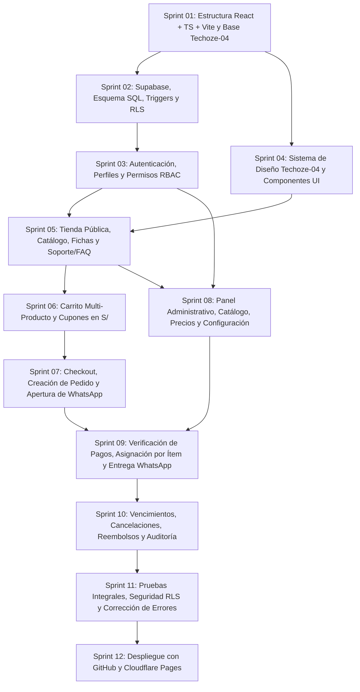

# Plan de Desarrollo por Sprints — SmartLab Store

**Metodología:** Desarrollo Iterativo por Sprints Ordenados por Dependencias  
**Objetivo General:** Construir una tienda digital comercial, funcional, segura y preparada para producción en el mercado peruano (`PEN` / `S/`), fiel al diseño **Techoze-04** y a las reglas operativas de **SmartLab Store**.  
**Documentos Base de Referencia:** `01_VISION_PROYECTO.md` a `07_SEGURIDAD.md`

---

## 1. Reglas y Principios de Trabajo del Proyecto

1. **Avance Secuencial (Un Sprint a la Vez):**
   - No se inicia un sprint hasta haber revisado y validado todos los entregables y criterios de aceptación del sprint anterior.
2. **Revisión Antes de Continuar y No Regresión:**
   - Todo cambio debe compilar sin errores (`tsc --noEmit` y `npm run build`) y mantener operativas las funcionalidades construidas en sprints previos.
3. **Cero Datos de Prueba Inventados en Producción:**
   - Queda prohibido incluir datos ficticios o pedidos falsos en producción. El entorno productivo solo contendrá las 6 categorías oficiales, configuración real y productos reales aprobados.
4. **Prioridad Absoluta en Seguridad, Pagos y Control de Entregas:**
   - La clave `service_role` nunca se expone en el frontend.
   - Autenticación del cliente mediante **correo electrónico + contraseña** (correo obligatorio y único para crear cuenta; verificación SMS desactivada inicialmente).
   - **El número de teléfono es obligatorio** para el checkout y el contacto por WhatsApp.
   - **El registro rápido está integrado en el checkout** y el cliente puede consultar sus pedidos y estados desde su cuenta.
   - El pedido se crea al finalizar el checkout (con **vencimiento predeterminado de 72 horas**, configurable desde el panel administrativo) y abre WhatsApp con el código y resumen.
   - Los comprobantes en revisión no confirman el pago.
   - Se permiten pagos parciales y, al vencer un pedido, se aplican las reglas financieras y de asignación de pagos definidas **sin eliminar pagos ni alterar saldos históricos**; un producto solo se entrega cuando está pagado al 100 %.
   - La entrega inicial se realiza manualmente mediante mensajes preparados de WhatsApp con enlaces de Google Drive/MediaFire (preparado para futura migración a enlaces temporales).
   - Un producto cuyo enlace ya fue enviado no es reembolsable.
5. **Actualización Continua de la Documentación:**
   - Cualquier cambio o decisión aprobada durante el desarrollo debe reflejarse inmediatamente en los documentos de la carpeta `docs/`.

---

## 2. Mapa General de Sprints y Grafo de Dependencias

---

## 3. Especificación Detallada de los 12 Sprints

---

### Sprint 01: Preparación del Proyecto y Estructura React + TypeScript + Vite
- **Objetivo:** Configurar la estructura modular del proyecto, el tipado base de TypeScript, las utilidades de formato en Soles (`S/`) y WhatsApp, y las variables CSS del diseño Techoze-04.
- **Funcionalidades Incluidas:**
  - Configuración estricta de TypeScript y estructura de carpetas (`config`, `types`, `services`, `context`, `utils`, `components`, `layouts`, `modules/store`, `modules/admin`, `routes`).
  - Variables CSS globales con la paleta y tipografía de Techoze-04 (`variables.css`, `reset.css`, `utilities.css`).
  - Definición completa de tipos TypeScript (`catalog.types.ts`, `order.types.ts`, `user.types.ts`) alineados al modelo de base de datos.
  - Utilidades base: formateador de moneda `PEN (S/)` (`currency.ts`) y generador de enlaces y mensajes preparados de WhatsApp (`whatsapp.ts`).
  - Enrutador principal (`AppRouter.tsx`) con separación entre tienda pública y panel administrativo.
- **Archivos / Módulos a Crear o Modificar:**
  - `/src/styles/variables.css`, `/src/styles/reset.css`, `/src/styles/utilities.css`
  - `/src/config/env.ts`
  - `/src/types/catalog.types.ts`, `/src/types/order.types.ts`, `/src/types/user.types.ts`
  - `/src/utils/currency.ts`, `/src/utils/whatsapp.ts`
  - `/src/routes/AppRouter.tsx`, `/src/App.tsx`, `/.env.example`
- **Dependencias:** Ninguna.
- **Criterios de Aceptación Verificables:**
  1. El proyecto compila sin errores de TypeScript (`npm run build`).
  2. Los tipos reflejan exactamente los estados de pedidos (`PENDIENTE_PAGO` a `REEMBOLSADO`, incluyendo `VENCIDO`), pagos y entregas por producto.
  3. No existe ninguna referencia a claves privadas en el código fuente del cliente.
- **Pruebas Necesarias:** Compilación del proyecto, verificación de rutas base y pruebas unitarias del formateador en Soles y generador de URLs de WhatsApp.
- **Resultado Esperado:** Estructura inicial limpia, tipada y lista para integrar Supabase.

---

### Sprint 02: Configuración de Supabase, Base de Datos, Migraciones y RLS
- **Objetivo:** Implementar el esquema PostgreSQL completo en Supabase, incluyendo tablas, restricciones `CHECK`, triggers de integridad financiera, buckets de Storage y políticas RLS.
- **Funcionalidades Incluidas:**
  - Migraciones SQL para los 11 grupos de tablas (`roles`, `profiles`, `customers`, `customer_addresses`, `custom_requests`, `categories`, `products`, `product_images`, `product_versions`, `download_links`, `carts`, `cart_items`, `orders`, `order_items`, `payments`, `payment_allocations`, `deliveries`, `coupons`, `coupon_usages`, `administrative_resolutions`, `order_cancellations`, `refunds`, `store_settings`, `order_status_history`, `audit_logs`).
  - Función `public.is_admin()` y políticas RLS en el 100 % de las tablas.
  - Triggers de negocio: prohibición de sobreasignación de pagos, cálculo automático de `is_fully_paid` al llegar al 100 %, preservación de pagos y saldos en pedidos `VENCIDO`, bloqueo de entregas pendientes en cancelaciones manuales y prohibición de reembolsos en productos con enlace enviado (`ENTREGADO`).
  - Configuración de buckets `public-assets` (público) y `payment-receipts` (privado).
- **Archivos / Módulos a Crear o Modificar:**
  - `/supabase/migrations/001_schema_tables.sql`
  - `/supabase/migrations/002_functions_and_triggers.sql`
  - `/supabase/migrations/003_rls_policies.sql`
  - `/supabase/migrations/004_storage_buckets.sql`
  - `/src/config/supabaseClient.ts`
- **Dependencias:** Sprint 01.
- **Criterios de Aceptación Verificables:**
  1. Todas las migraciones se ejecutan sin errores en PostgreSQL de Supabase.
  2. En `profiles`, `orders` y `custom_requests`, tanto el correo electrónico (`NOT NULL`, `UNIQUE` en `profiles`) como el teléfono (`NOT NULL`) son obligatorios; además, `orders.expires_at` se calcula por defecto a **72 horas** según `store_settings.order_expiration_hours = 72`.
  3. Las consultas anónimas o de clientes sobre `download_links` y `deliveries` de productos no pagados al 100 % devuelven cero registros.
- **Pruebas Necesarias:** Pruebas SQL de restricciones `CHECK`, unicidad de correo, triggers de no sobreasignación, vencimiento a las 72 horas conservando pagos históricos y verificación de RLS por rol (`anon`, `customer`, `admin`).
- **Resultado Esperado:** Base de datos relacional y políticas de seguridad operativas en Supabase.

---

### Sprint 03: Autenticación, Perfiles y Permisos (RBAC)
- **Objetivo:** Desarrollar el flujo de registro, inicio y cierre de sesión de clientes y administradores mediante **correo electrónico + contraseña**, garantizando que el correo sea obligatorio y único, el teléfono sea obligatorio para checkout/WhatsApp y la verificación SMS esté desactivada inicialmente.
- **Funcionalidades Incluidas:**
  - Servicio y contexto de autenticación (`auth.service.ts`, `AuthContext.tsx`) conectados a Supabase Auth (`signUp` y `signInWithPassword` con correo electrónico + contraseña, sin OTP por SMS).
  - Pantallas de Registro e Inicio de Sesión de clientes (`/login`, `/registro`) y componente reutilizable de **Registro Rápido Integrado para el Checkout**, donde **el correo electrónico es obligatorio y único, y el teléfono/WhatsApp es obligatorio**.
  - Gestión de perfil del cliente (`/mi-cuenta/perfil`) y estructura base de cuenta del cliente (`/mi-cuenta`) para consultar pedidos y estados.
  - Guardianes de rutas `<PrivateRoute>` y `<AdminRoute>` sincronizados con el rol real en `public.profiles`.
- **Corrección Retroactiva al Sprint 03 (Ejecutada en Sprint 09 — Acceso y Configuración Segura del Administrador):**
  - **Auditoría y Blindaje contra Autoasignación de Rol:** Se eliminó el `.upsert()` de perfil desde el cliente durante el registro en `auth.service.ts` para que todo usuario registrado obtenga exclusivamente `role_id = 'customer'` a través del trigger `trg_on_auth_user_created`, ignorando cualquier metadato en `raw_user_meta_data`.
  - **Trigger de No Escalamiento (`trg_prevent_profile_role_escalation`):** Añadido en `/supabase/migrations/005_admin_bootstrap_and_role_hardening.sql` para impedir que un usuario modifique directamente su propio `role_id`, `is_active` o `email` mediante llamadas a la API con `anon key`.
  - **Procedimiento Controlado de Creación del Primer `ADMIN`:** Implementada la función `public.promote_user_to_admin(p_email TEXT)` (`SECURITY DEFINER`, ejecutable únicamente desde el SQL Editor de Supabase o por otro admin activo) que promueve una cuenta registrada a `role_id = 'admin'` y deja constancia en `public.audit_logs`, sin exponer jamás `service_role` en el navegador.
  - **Control Estricto en `/admin` y Login:** `<AdminRoute>` redirige a `/login` si no existe sesión y muestra pantalla de bloqueo `403 Acceso Denegado (RBAC)` si la sesión activa no posee rol `ADMIN` (`admin` / `ADMIN`). `LoginPage.tsx` redirige automáticamente a `/admin` cuando el usuario autenticado tiene rol `ADMIN`.
- **Archivos / Módulos a Crear o Modificar:**
  - `/supabase/migrations/005_admin_bootstrap_and_role_hardening.sql` *(Corrección Retroactiva Sprint 03)*
  - `/src/types/user.types.ts`
  - `/src/services/auth.service.ts`
  - `/src/context/AuthContext.tsx`
  - `/src/components/guards/PrivateRoute.tsx`, `/src/components/guards/AdminRoute.tsx`
  - `/src/modules/store/account/LoginPage.tsx`, `/src/modules/store/account/RegisterPage.tsx`, `/src/modules/store/account/ProfilePage.tsx`
- **Dependencias:** Sprint 02.
- **Criterios de Aceptación Verificables:**
  1. Un cliente puede registrarse e iniciar sesión con correo electrónico único + contraseña y teléfono obligatorio (sin verificación SMS), recibiendo siempre el rol `customer`.
  2. El sistema rechaza cualquier intento de registro con un correo electrónico ya existente o sin número de teléfono válido, e impide que un usuario se asigne a sí mismo el rol `ADMIN` por registro, metadatos, frontend o consulta directa.
  3. El primer administrador se habilita de forma controlada en Supabase (`SELECT public.promote_user_to_admin('correo@dominio.com');`), inicia sesión con correo y contraseña y accede a `/admin`.
  4. Si no existe sesión al visitar `/admin/*`, el sistema redirige a `/login`; si existe sesión sin rol `ADMIN`, deniega el acceso (`403`) y las políticas RLS bloquean toda operación administrativa en base de datos.
- **Pruebas Necesarias:** Registro de cliente con correo único + contraseña + teléfono obligatorio; rechazo de correos duplicados; promoción controlada del primer `ADMIN` en Supabase; inicio y cierre de sesión; prueba de redirección sin sesión y bloqueo `403` con sesión de cliente en `/admin`.
- **Resultado Esperado:** Sistema de cuentas, promoción controlada del primer administrador y control de permisos por rol (RBAC + RLS) completamente blindado.

---

### Sprint 04: Diseño Visual Techoze-04 y Componentes Reutilizables
- **Objetivo:** Construir el layout público fiel a **Techoze-04**, el layout administrativo operativo y la biblioteca de componentes reutilizables.
- **Funcionalidades Incluidas:**
  - Componentes comunes: Botones, Badges (`FREE`, `PRO`, `PERSONALIZADO`, descuentos), Modales, Alertas, Tablas y Cargadores con CSS modular.
  - `PublicLayout` fiel a Techoze-04:
    - Top Bar informativa con moneda `PEN (S/)`.
    - Main Header con logo SmartLab Store, mega-buscador con filtro de categorías, acceso a cuenta y mini-carrito.
    - Navigation Bar con menú vertical desplegable de las 6 categorías oficiales y botón de WhatsApp oficial.
    - Footer oscuro (`#0F172A`) de 4 columnas y barra móvil inferior fija.
  - `AdminLayout`: Sidebar oscura (`#0F172A`), barra superior operativa y contenedor de trabajo de alta densidad.
- **Archivos / Módulos a Crear o Modificar:**
  - `/src/components/common/Button/`, `/src/components/common/Badge/`, `/src/components/common/Modal/`, `/src/components/common/Table/`
  - `/src/layouts/PublicLayout/PublicLayout.tsx`, `/src/layouts/PublicLayout/Header.tsx`, `/src/layouts/PublicLayout/Footer.tsx`
  - `/src/layouts/AdminLayout/AdminLayout.tsx`, `/src/layouts/AdminLayout/AdminSidebar.tsx`
- **Dependencias:** Sprint 01, Sprint 03.
- **Criterios de Aceptación Verificables:**
  1. El encabezado, menú vertical, paleta de colores, proporciones y tipografía reproducen fielmente la apariencia de Techoze-04.
  2. El diseño responde correctamente en Desktop, Tablet y Móvil.
- **Pruebas Necesarias:** Verificación visual comparativa con Techoze-04 y pruebas de comportamiento responsive en los 4 puntos de quiebre.
- **Resultado Esperado:** Estructura visual completa de la tienda pública y del panel administrativo.

---

### Sprint 05: Tienda Pública, Catálogo, Categorías, Productos y Soporte/FAQ
- **Objetivo:** Implementar todas las vistas de exploración comercial de la tienda pública, solicitudes personalizadas y páginas de contacto/FAQ.
- **Funcionalidades Incluidas:**
  - Página de Inicio (`HomePage.tsx`): Hero con menú vertical de las 6 categorías, slider principal y 2 banners laterales apilados; barra de propuesta de valor de 4 columnas; sección *Deal of the Day* con cuenta regresiva; cuadrículas por pestañas (*Destacados*, *Más Vendidos*, *Novedades*, *Ofertas* y categorías); banners dobles intermedios y zona de recursos `FREE`.
  - Tarjeta de producto Techoze-04 (`ProductCard.tsx`) y modal de Vista Rápida (`QuickViewModal.tsx`).
  - Catálogo completo (`CatalogPage.tsx`) con buscador por palabras clave y filtros combinables por categoría, modalidad (`FREE`, `PRO`, `PERSONALIZADO`) y rango de precios en `S/`.
  - Ficha detallada de producto (`ProductDetailPage.tsx`) con galería, descripción, características, requisitos técnicos, versión e historial de versiones.
  - Formulario de solicitud de productos personalizados (`CustomRequestPage.tsx`, teléfono obligatorio y correo opcional).
  - Página de Contacto y Preguntas Frecuentes (`SupportFaqPage.tsx`).
- **Archivos / Módulos a Crear o Modificar:**
  - `/src/services/catalog.service.ts`
  - `/src/modules/store/home/HomePage.tsx`, `/src/modules/store/home/DealOfTheDay.tsx`, `/src/modules/store/home/CategoryTabs.tsx`
  - `/src/modules/store/catalog/CatalogPage.tsx`, `/src/modules/store/catalog/ProductCard.tsx`, `/src/modules/store/catalog/QuickViewModal.tsx`
  - `/src/modules/store/product-detail/ProductDetailPage.tsx`
  - `/src/modules/store/custom-request/CustomRequestPage.tsx`
  - `/src/modules/store/support/SupportFaqPage.tsx`
- **Dependencias:** Sprint 02, Sprint 04.
- **Criterios de Aceptación Verificables:**
  1. Todas las secciones de inicio, catálogo y ficha muestran precios en `S/` y distinguen claramente productos `FREE`, `PRO` y `PERSONALIZADO`.
  2. Las fichas de producto jamás exponen las URLs de Google Drive o MediaFire.
  3. El formulario de productos personalizados exige nombre, correo electrónico y teléfono obligatorio para contacto por WhatsApp.
- **Pruebas Necesarias:** Pruebas de búsqueda, filtrado por las 6 categorías, visualización de fichas y envío de solicitud personalizada.
- **Resultado Esperado:** Tienda pública completa, navegable y conectada al catálogo de Supabase.

---

### Sprint 06: Carrito de Compras y Validación de Cupones
- **Objetivo:** Implementar el carrito de compras multi-producto en Soles (`S/`), el mini-carrito desplegable y la aplicación de cupones de descuento.
- **Funcionalidades Incluidas:**
  - Contexto de carrito (`CartContext.tsx`) con soporte para agregar múltiples productos digitales (licencia unitaria `quantity = 1` sin duplicados).
  - Drawer de Mini-Carrito en el encabezado y página completa de Carrito (`CartPage.tsx`).
  - Servicio de validación de cupones (`coupons.service.ts`) verificando vigencia, compra mínima en `S/`, límite de usos y cálculo de descuento porcentual o fijo.
- **Archivos / Módulos a Crear o Modificar:**
  - `/src/context/CartContext.tsx`
  - `/src/services/coupons.service.ts`
  - `/src/modules/store/cart/MiniCartDrawer.tsx`, `/src/modules/store/cart/CartPage.tsx`
- **Dependencias:** Sprint 05.
- **Criterios de Aceptación Verificables:**
  1. El carrito permite reunir varios productos en un mismo pedido y calcula con exactitud el importe bruto, descuento y total neto en `S/`.
  2. No se permite agregar dos veces el mismo producto ni generar importes negativos al aplicar un cupón.
- **Pruebas Necesarias:** Adición y eliminación de múltiples productos, aplicación de cupones válidos e inválidos y persistencia del carrito.
- **Resultado Esperado:** Carrito de compras multi-producto listo para conectarse con el checkout.

---

### Sprint 07: Checkout con Registro Rápido, Creación de Pedidos y Comprobantes por WhatsApp
- **Objetivo:** Implementar el checkout con registro rápido integrado, creación del pedido al finalizar (con vencimiento predeterminado de 72 horas), apertura de WhatsApp con el código y resumen del pedido, y consulta de pedidos y estados desde la cuenta del cliente.
- **Funcionalidades Incluidas:**
  - Pantalla de Checkout (`CheckoutPage.tsx`):
    - **Registro rápido integrado en el checkout:** Si el usuario no ha iniciado sesión, crea su cuenta en el mismo formulario ingresando **correo electrónico obligatorio y único + contraseña**, nombre completo y **número de teléfono obligatorio para WhatsApp** (sin verificación SMS inicial), o inicia sesión si ya tiene cuenta.
    - Selector de método de pago (**Yape**, **Plin**, **Transferencia bancaria**) mostrando QR, números y cuentas oficiales en Soles.
  - Creación transaccional del pedido al finalizar el checkout:
    - Inserta el pedido en `orders` (`PENDIENTE_PAGO`) con **vencimiento predeterminado de 72 horas** (según `order_expiration_hours` en `store_settings`) y guarda los snapshots históricos de título, versión y precio en `order_items`.
    - **Abre automáticamente WhatsApp** con el código único del pedido, detalle de productos y monto total en `S/` para que el cliente envíe manualmente su comprobante.
  - Consulta de Pedidos y Estados desde la Cuenta del Cliente (`MyOrdersPage.tsx`, `OrderDetailPage.tsx`):
    - Permite al cliente consultar en su cuenta todos sus pedidos, su estado general, su plazo de vencimiento y el **estado de pago y entrega individual de cada producto** (monto pagado asignado, saldo pendiente y aviso de que los comprobantes en revisión no confirman el pago).
    - Permite subir opcionalmente la captura del comprobante o abrir WhatsApp para enviar nuevos comprobantes de pagos parciales.
- **Archivos / Módulos a Crear o Modificar:**
  - `/src/services/orders.service.ts`, `/src/services/storage.service.ts`
  - `/src/modules/store/checkout/CheckoutPage.tsx`, `/src/modules/store/checkout/QuickAuthSection.tsx`, `/src/modules/store/checkout/PaymentMethodSelector.tsx`
  - `/src/modules/store/account/MyOrdersPage.tsx`, `/src/modules/store/account/OrderDetailPage.tsx`
- **Dependencias:** Sprint 03, Sprint 06.
- **Criterios de Aceptación Verificables:**
  1. Un comprador visitante puede completar el registro rápido integrado en el checkout (correo obligatorio y único + contraseña + teléfono obligatorio) y crear su pedido en un solo flujo.
  2. El pedido se crea al finalizar el checkout con vencimiento predeterminado de 72 horas y abre WhatsApp con el código y resumen estructurado del pedido.
  3. El cliente puede consultar sus pedidos y estados desde su cuenta; mientras el comprobante está en revisión (`PENDIENTE` / `PAGO_EN_REVISION`), el saldo pagado se mantiene en `S/ 0.00` y ningún enlace se muestra al cliente.
- **Pruebas Necesarias:** Checkout con registro rápido de cliente nuevo y con cliente ya autenticado; verificación de snapshots históricos y fecha de vencimiento (+72h) en base de datos; consulta de pedidos desde la cuenta del cliente.
- **Resultado Esperado:** Flujo de checkout con registro rápido, apertura de WhatsApp y consulta de pedidos en cuenta funcionando de extremo a extremo.

---

### Sprint 08: Panel Administrativo — Dashboard, Catálogo, Precios, Clientes y Configuración
- **Objetivo:** Construir los módulos administrativos para gestionar el catálogo completo, enlaces iniciales de Drive/MediaFire, precios, promociones, cupones, clientes y configuración general de la tienda (incluyendo el plazo de vencimiento de pedidos predeterminado en 72 horas).
- **Funcionalidades Incluidas:**
  - Dashboard Comercial (`DashboardPage.tsx`) con KPIs de ingresos verificados en `S/`, comprobantes en revisión, productos pagados al 100 % listos para entrega por WhatsApp y solicitudes personalizadas.
  - Gestión de Productos, Categorías, Imágenes y Versiones (`ProductsAdminPage.tsx`, `ProductFormModal.tsx`): CRUD de productos (`FREE`, `PRO`, `PERSONALIZADO`), subida de imágenes a `public-assets`, registro de versiones y carga de enlaces iniciales en **Google Drive** y **MediaFire** (`download_links`).
  - Gestión de Precios y Promociones (`PricingAdminPage.tsx`) y Gestión de Cupones (`CouponsAdminPage.tsx`).
  - Gestión de Clientes (`CustomersAdminPage.tsx`) y bandeja de Solicitudes Personalizadas (`CustomRequestsAdminPage.tsx`).
  - Configuración General (`SettingsAdminPage.tsx`): Edición de cuentas bancarias, números y QR de Yape/Plin, WhatsApp oficial, **plazo de vencimiento de pedidos (`order_expiration_hours`, predeterminado en 72 horas y configurable)**, banners y FAQs.
- **Archivos / Módulos a Crear o Modificar:**
  - `/src/services/admin.service.ts`
  - `/src/modules/admin/dashboard/DashboardPage.tsx`
  - `/src/modules/admin/products/ProductsAdminPage.tsx`, `/src/modules/admin/products/ProductFormModal.tsx`
  - `/src/modules/admin/pricing/PricingAdminPage.tsx`
  - `/src/modules/admin/coupons/CouponsAdminPage.tsx`
  - `/src/modules/admin/customers/CustomersAdminPage.tsx`
  - `/src/modules/admin/orders/CustomRequestsAdminPage.tsx`
  - `/src/modules/admin/reports-settings/SettingsAdminPage.tsx`
- **Dependencias:** Sprint 03, Sprint 04, Sprint 05.
- **Criterios de Aceptación Verificables:**
  1. El administrador puede crear y editar productos, versiones y enlaces de Drive/MediaFire sin que dichos enlaces sean visibles públicamente.
  2. La modificación del precio de un producto en catálogo no altera los importes ni snapshots de los pedidos creados previamente.
  3. Los cambios en cuentas de Yape/Plin/Bancos y WhatsApp oficial se reflejan dinámicamente en el checkout.
- **Pruebas Necesarias:** Alta y edición de productos, versiones, promociones, cupones y parámetros de configuración con cuenta de administrador.
- **Resultado Esperado:** Administración integral del catálogo, clientes y configuración operativa de SmartLab Store.

---

### Sprint 09: Verificación Administrativa de Pagos, Asignación por Producto y Entregas por WhatsApp
- **Objetivo:** Implementar el núcleo financiero y de despacho del panel administrativo: verificación manual de pagos, asignación de importes por producto (incluyendo pagos parciales) y entrega individual mediante mensajes preparados de WhatsApp.
- **Funcionalidades Incluidas:**
  - Gestión de Pedidos (`OrdersAdminPage.tsx`) con vista del desglose por producto.
  - Verificación Manual de Pagos (`PaymentsAdminPage.tsx`):
    - Registro de comprobantes recibidos por WhatsApp o revisión de comprobantes subidos en web (Yape, Plin, transferencia bancaria).
    - Aprobación (`APROBADO` con definición de `amount_verified`), observación (`OBSERVADO`) o rechazo (`RECHAZADO`).
  - **Asignación de Pagos por Producto (`PaymentAllocationModal.tsx`):**
    - Distribución del `amount_verified` entre los productos del pedido (`payment_allocations`).
    - Validación estricta contra sobreasignaciones.
    - Soporte de pagos parciales: actualiza el saldo pagado y pendiente de cada producto, marcando `is_fully_paid = true` (`LISTO_PARA_ENTREGA`) únicamente en los productos que alcanzan el 100 % de su precio neto.
  - **Gestión de Entregas Individuales por WhatsApp (`DeliveriesAdminPage.tsx`):**
    - Bloquea técnicamente cualquier producto que no esté pagado al 100 %.
    - Para cada producto con 100 % de pago verificado, permite seleccionar su enlace de Google Drive/MediaFire (o definir un enlace personalizado) y **abrir WhatsApp con el mensaje preparado de entrega individual** hacia el teléfono del cliente, registrando `sent_at`, `sent_by_user_id` y cambiando el estado del ítem a `ENTREGADO`.
- **Archivos / Módulos a Crear o Modificar:**
  - `/src/services/payments.service.ts`, `/src/services/deliveries.service.ts`
  - `/src/modules/admin/orders/OrdersAdminPage.tsx`
  - `/src/modules/admin/payments/PaymentsAdminPage.tsx`, `/src/modules/admin/payments/PaymentAllocationModal.tsx`
  - `/src/modules/admin/deliveries/DeliveriesAdminPage.tsx`
- **Dependencias:** Sprint 07, Sprint 08.
- **Criterios de Aceptación Verificables:**
  1. Un comprobante en revisión (`PENDIENTE`) no suma al saldo pagado ni permite asignar importes hasta ser `APROBADO`.
  2. En un pedido con varios productos y un pago parcial, el administrador puede asignar el importe para cubrir al 100 % un producto y dejar otro con saldo parcial; el sistema habilita la entrega por WhatsApp únicamente del producto pagado al 100 % y mantiene bloqueado el segundo.
  3. El sistema impide asignar un monto superior al `amount_verified` o superior al saldo pendiente del producto.
- **Pruebas Necesarias:** Verificación y asignación de pago total; verificación y distribución de pago parcial en pedido multi-producto; intento de sobreasignación; envío de enlace individual preparado por WhatsApp.
- **Resultado Esperado:** Control exacto de pagos, saldos por producto y entregas individuales por WhatsApp.

---

### Sprint 10: Vencimientos (72h Configurables), Cancelaciones, Reembolsos, Reportes y Auditoría
- **Objetivo:** Implementar el manejo de pedidos vencidos (72 horas predeterminadas, configurable desde el panel administrativo) sin eliminar pagos ni alterar saldos históricos, las cancelaciones manuales con bloqueo de entregas pendientes y resolución administrativa, los reembolsos exclusivos para productos no entregados y la bitácora de auditoría.
- **Funcionalidades Incluidas:**
  - **Gestión de Pedidos Vencidos:** Transición al estado `VENCIDO` cuando expira el plazo configurado (72 horas por defecto), aplicando las reglas financieras y de asignación de pagos ya definidas, **sin eliminar pagos ni alterar saldos históricos**, y permitiendo su reactivación o resolución administrativa.
  - **Cancelaciones Manuales y Resoluciones Administrativas (`CancellationsAdminPage.tsx`):**
    - Al cancelar manualmente un pedido, el sistema **bloquea automáticamente todas las entregas pendientes** (`REVOCADO` / `is_enabled = false`) y exige registrar una resolución administrativa en `administrative_resolutions`.
  - **Gestión de Reembolsos (`RefundsAdminPage.tsx`):**
    - Bloqueo absoluto de reembolso sobre cualquier producto cuyo enlace ya fue enviado (`ENTREGADO` / `sent_at IS NOT NULL`).
    - Evaluación de reembolso únicamente sobre productos no entregados que cuenten con saldo pagado.
    - Cierre del reembolso (`COMPLETADO`) exclusivamente cuando se registra la devolución efectiva del dinero (monto en `S/`, método Yape/Plin/Banco, cuenta de destino, titular, número de operación y comprobante).
  - **Reportes Comerciales y Bitácora de Auditoría (`ReportsAdminPage.tsx`, `AuditLogsAdminPage.tsx`):**
    - Reportes de ventas verificadas, saldos en pedidos parciales/vencidos y reembolsos.
    - Consulta inmutable de `audit_logs`.
- **Archivos / Módulos a Crear o Modificar:**
  - `/src/services/cancellations.service.ts`
  - `/src/modules/admin/cancellations/CancellationsAdminPage.tsx`, `/src/modules/admin/cancellations/RefundModal.tsx`
  - `/src/modules/admin/audit/AuditLogsAdminPage.tsx`
  - `/src/modules/admin/reports-settings/ReportsAdminPage.tsx`
- **Dependencias:** Sprint 09.
- **Criterios de Aceptación Verificables:**
  1. Al pasar un pedido a `VENCIDO`, sus pagos verificados y saldos asignados por producto se conservan sin alteración.
  2. Toda cancelación manual bloquea las entregas pendientes y no puede guardarse sin su resolución administrativa.
  3. El sistema rechaza cualquier intento de reembolsar un producto cuyo enlace ya fue enviado (`ENTREGADO`).
  4. Un reembolso de producto no entregado solo pasa a `COMPLETADO` cuando se registran los datos y referencia de la devolución efectiva del dinero.
- **Pruebas Necesarias:** Vencimiento y reactivación de pedido con pago parcial; cancelación manual con bloqueo de entregas; intento de reembolso de ítem entregado (debe fallar); registro de reembolso efectivo de ítem no entregado; verificación de registros en `audit_logs`.
- **Resultado Esperado:** Ciclo administrativo financiero, de excepciones y auditoría 100 % completo.

---

### Sprint 11: Pruebas Funcionales, Auditoría de Seguridad y Corrección de Errores (COMPLETADO)
- **Objetivo:** Ejecutar las pruebas integrales de extremo a extremo (E2E) y la lista de verificación de seguridad antes del despliegue a producción.
- **Funcionalidades Incluidas:**
  - Ejecución completa del checklist de seguridad definido en `07_SEGURIDAD.md` (RLS en todas las tablas, ausencia de `service_role` en el bundle de frontend, privacidad del bucket `payment-receipts` y protección de `download_links` / `deliveries`).
  - Pruebas integrales de todos los flujos comerciales definidos en `05_PEDIDOS_PAGOS.md` y sincronización E2E entre el portal del cliente (`OrderDetailPage.tsx`), el Dashboard administrativo (`DashboardPage.tsx`) y la bitácora inmutable (`audit_logs`).
  - Configuración de cabeceras de seguridad HTTP en `/public/_headers` y reglas de enrutamiento SPA en `/public/_redirects`.
  - Optimización de rendimiento, carga diferida (*lazy loading* con `React.lazy` y `Suspense` en `AppRouter.tsx`) del panel administrativo y endurecimiento de compatibilidad en `003_rls_policies.sql`.
- **Archivos / Módulos Creados o Modificados:**
  - `/public/_headers`, `/public/_redirects`
  - `/src/routes/AppRouter.tsx`
  - `/src/services/orders.service.ts`, `/src/services/payments.service.ts`, `/src/services/deliveries.service.ts`, `/src/services/admin.service.ts`
  - `/src/modules/store/account/OrderDetailPage.tsx`
  - `/supabase/migrations/003_rls_policies.sql`
  - `/docs/07_SEGURIDAD.md`, `/docs/08_PLAN_SPRINTS.md`
- **Dependencias:** Sprints 01 al 10.
- **Criterios de Aceptación Verificables:**
  1. El 100 % de las pruebas de seguridad RLS y reglas comerciales superan la validación sin brechas.
  2. La compilación de producción (`npm run build`) genera paquetes optimizados con *code-splitting* del panel administrativo, sin advertencias ni exposición de secretos.
- **Pruebas Necesarias:** Batería completa de pruebas E2E (compra, WhatsApp, pago parcial, vencimiento, asignación, entrega al 100 %, cancelación y reembolso) y pruebas de penetración sobre RLS.
- **Resultado Esperado:** Aplicación validada, segura y lista para producción.

---

### Sprint 12: Despliegue con GitHub y Cloudflare Pages
- **Objetivo:** Configurar el flujo de despliegue continuo desde GitHub hacia Cloudflare Pages y poner en marcha SmartLab Store en producción sin datos de prueba ficticios.
- **Funcionalidades Incluidas:**
  - Configuración de flujo de verificación de compilación en GitHub (`.github/workflows/ci.yml`).
  - Vinculación del repositorio de GitHub con **Cloudflare Pages** (`npm run build`, directorio `dist`) y configuración de las variables públicas `VITE_SUPABASE_URL` y `VITE_SUPABASE_ANON_KEY`.
  - Aplicación de las migraciones SQL en el proyecto productivo de Supabase y carga exclusiva de las 6 categorías oficiales y configuración real de la tienda (cero datos de prueba inventados).
  - Verificación final en el dominio de producción con HTTPS activo.
- **Archivos / Módulos a Crear o Modificar:**
  - `/.github/workflows/ci.yml`
  - Actualización final de estado en `/docs/08_PLAN_SPRINTS.md`
- **Dependencias:** Sprint 11.
- **Criterios de Aceptación Verificables:**
  1. El despliegue en Cloudflare Pages finaliza exitosamente desde la rama `main` de GitHub.
  2. Todas las rutas públicas, de cliente y de administrador responden con HTTPS y cabeceras de seguridad activas.
  3. La base de datos de producción está limpia de datos ficticios y lista para operar comercialmente.
- **Pruebas Necesarias:** Verificación post-despliegue de navegación, autenticación, creación de pedido real, apertura de WhatsApp y panel administrativo en producción.
- **Resultado Esperado:** **SmartLab Store** en producción, segura y operativa.
