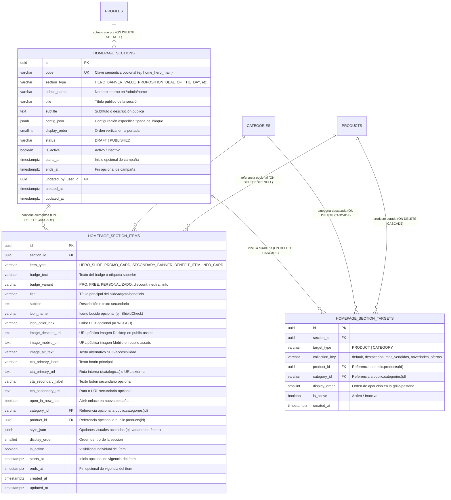

# Arquitectura de Portada Dinámica y Promociones Administrables — SmartLab Store

**Proyecto:** SmartLab Store  
**Sprint:** C1 — Auditoría, Arquitectura y Diseño de Base de Datos para la Página de Inicio  
**Stack Técnico:** React + TypeScript + Vite + Supabase (PostgreSQL, Auth, RLS, Storage)  
**Moneda Base:** Soles Peruanos (`PEN` / `S/`)  
**Documentos Relacionados:** `03_ARQUITECTURA.md`, `04_BASE_DATOS.md`, `06_DISENO_VISUAL_UX_UI.md`, `07_SEGURIDAD.md`, `08_PLAN_SPRINTS.md`

---

## 1. Diagnóstico de la Página de Inicio Actual

La página de inicio actual (`/` → `src/modules/store/home/HomePage.tsx`), junto con sus subcomponentes `CategoryTabs.tsx` y `DealOfTheDay.tsx`, presenta una arquitectura **híbrida**:

- **Datos Dinámicos Conectados a Supabase:**
  - Las **categorías activas** se consultan desde `public.categories` mediante `getCategories()` (`src/services/catalog.service.ts`), respetando `is_active = true`, `display_order`, `icon_name`, `color_hex` e `image_url` (implementado en los Sprints B2, B3, B4 y B5).
  - Los **productos del catálogo** se consultan desde `public.products` (con `product_images` y `product_versions`) mediante `getProducts()`, utilizando banderas booleanas (`is_featured`, `is_bestseller`, `is_new`, `is_on_promotion`, `promo_ends_at`) y modalidad (`FREE`, `PRO`, `PERSONALIZADO`).
- **Contenidos Estáticos Hardcodeados en Código Fuente (`HomePage.tsx`, `CategoryTabs.tsx`, `DealOfTheDay.tsx`):**
  - El **Hero Slider** (`HERO_SLIDES` en `HomePage.tsx`, líneas 40–74) está definido como un arreglo constante de 3 slides en TypeScript sin soporte para imágenes de escritorio/móvil ni administración desde base de datos.
  - Las **2 tarjetas promocionales laterales** del Hero (líneas 237–283) tienen textos, badges (`OFERTA -25%`, `A MEDIDA`), precios de referencia (`formatPEN(180)`) y enlaces fijos en el JSX.
  - La **barra de propuesta de valor / beneficios** de 4 columnas (líneas 287–346) tiene iconos Lucide, títulos y descripciones codificados directamente en el componente.
  - Los **títulos y subtítulos de sección** (como el encabezado de `DealOfTheDay.tsx`, el encabezado de `CategoryTabs.tsx`, la cabecera de la Zona `FREE` y el bloque inferior de Solicitudes Personalizadas) están fijos en el código.
  - Los **2 banners intermedios duales (50% / 50%)** (líneas 367–405) tienen textos, gradientes, badges y enlaces estáticos en el JSX.
  - El **orden vertical y la visibilidad** de las 7 secciones de la portada están fijados de forma rígida en el árbol JSX de `HomePage.tsx`.
- **Desconexión Detectada en `SettingsAdminPage.tsx`:**
  - En `src/modules/admin/reports-settings/SettingsAdminPage.tsx` (líneas 728–761) existen dos campos de formulario (`heroBannerTitle` y `promoBarText`), pero **no se persisten en `public.store_settings`** dentro de `saveAdminStoreSettings()` (`src/services/admin.service.ts`, líneas 1814–1845) ni son leídos por `HomePage.tsx` o `Header.tsx`.

---

## 2. Inventario de Secciones Existentes en la Portada

Actualmente, `HomePage.tsx` renderiza **7 secciones secuenciales** dentro del contenedor `.smartlab-container`:

| # | Orden Actual | Sección / Bloque Visual | Archivo / Componente | Origen Actual de Datos | Estado de Administración |
| :-: | :-: | :--- | :--- | :--- | :--- |
| **1A** | 1 (Izq. `lg:col-span-8`) | **Hero Banner Principal (Slider Panorámico)** | `src/modules/store/home/HomePage.tsx` (`HERO_SLIDES`) | Arreglo estático `HERO_SLIDES` en código; enlace de `sistemas` resuelto con `findActiveCategoryBySlugOrEquivalent()` | **100 % Estático en código** (3 slides fijos, sin imágenes Desktop/Mobile) |
| **1B** | 1 (Der. `lg:col-span-4`) | **Tarjetas Promocionales Laterales del Hero (2 tarjetas apiladas)** | `src/modules/store/home/HomePage.tsx` (líneas 237–283) | JSX estático + `resolveCategoryCatalogLink('sistemas')` | **100 % Estático en código** |
| **2** | 2 | **Barra de Propuesta de Valor / Beneficios (4 columnas)** | `src/modules/store/home/HomePage.tsx` (líneas 287–346) | JSX estático (4 tarjetas con iconos `ShieldCheck`, `MessageCircle`, `RefreshCw`, `Sparkles`) | **100 % Estático en código** |
| **3** | 3 | **Oferta Destacada del Día (*Deal of the Day*) con Temporizador** | `src/modules/store/home/DealOfTheDay.tsx` | Producto obtenido de `getProducts()` (`is_deal_of_the_day` / `is_on_promotion` / `products[0]`); textos de cabecera fijos en JSX | **Parcialmente Dinámico** (producto desde BD; título, subtítulo, visibilidad de sección y selección directa fijos) |
| **4** | 4 | **Vitrina por Pestañas (Colecciones + Categorías Activas)** | `src/modules/store/home/CategoryTabs.tsx` | Categorías desde `getCategories()` (Supabase `public.categories`) y productos desde `getProducts()` (`is_featured`, `is_bestseller`, `is_new`, `is_on_promotion`) | **Parcialmente Dinámico** (categorías y banderas de producto desde BD; título, subtítulo, límite de 8 ítems y pestañas de colección fijos en JSX) |
| **5** | 5 | **Banners Secundarios / Intermedios Duales (50% / 50%)** | `src/modules/store/home/HomePage.tsx` (líneas 367–405) | JSX estático + `resolveCategoryCatalogLink('excel' / 'android_apps')` | **100 % Estático en código** |
| **6** | 6 | **Zona de Recursos Digitales Gratuitos (`FREE — S/ 0.00`)** | `src/modules/store/home/HomePage.tsx` (líneas 407–443) | Productos filtrados con `p.modalidad === 'FREE'` desde `getProducts()`; cabecera, badge y botón CTA fijos en JSX | **Parcialmente Dinámico** (productos desde BD; textos de cabecera, cantidad máxima y visibilidad fijos) |
| **7** | 7 | **Bloque Informativo / CTA de Productos Personalizados a Medida** | `src/modules/store/home/HomePage.tsx` (líneas 445–474) | JSX estático con enlaces a `/solicitud-personalizada` y `/soporte` | **100 % Estático en código** |

*(Adicionalmente, en `src/layouts/PublicLayout/Header.tsx`, líneas 112–138, existe la **Top Bar Informativa** con texto estático en código).*

---

## 3. Funcionalidades que Ya Están Implementadas

1. **Sistema Dinámico de Categorías (Sprints B2, B3, B4 y B5):**
   - Tabla `public.categories` con soporte para `id`, `name`, `slug`, `description`, `icon_name`, `color_hex`, `image_url`, `display_order` e `is_active`.
   - Componente transversal `<CategoryVisual />` (`src/components/common/CategoryVisual/CategoryVisual.tsx`) que renderiza la imagen personalizada de `public-assets/categories/` o el icono Lucide con su `color_hex` configurado.
   - Resolución resiliente de slugs e IDs equivalentes (`findActiveCategoryBySlugOrEquivalent`, `doesProductMatchCategorySlug`) en `src/services/catalog.service.ts`.
2. **Catálogo de Productos y Banderas Comerciales en Base de Datos:**
   - Tabla `public.products` con banderas `is_featured` (Destacados), `is_bestseller` (Más vendidos), `is_new` (Novedades), `is_on_promotion` (En oferta), `promotional_price`, `promo_ends_at` y `product_type` (`FREE`, `PRO`, `PERSONALIZADO`).
   - Componentes `ProductCard.tsx` y `QuickViewModal.tsx` completamente funcionales e integrados con el carrito (`useCart`).
3. **Infraestructura de Almacenamiento Público (`public-assets`):**
   - Bucket público `public-assets` creado en `supabase/migrations/004_storage_buckets.sql` con límite de 5 MB, formatos `image/jpeg`, `image/png`, `image/webp`, `image/svg+xml` y políticas RLS que permiten lectura pública (`SELECT`) y restringen `INSERT`, `UPDATE` y `DELETE` a `public.is_admin()`.
   - Funciones reutilizables `uploadPublicStoreAsset()` y `deletePublicStoreAsset()` en `src/services/storage.service.ts` con validación de rol `ADMIN`, reintentos automáticos y extracción segura de rutas (`extractPublicAssetStoragePath`).
4. **Seguridad RBAC y RLS Administrativa:**
   - Función `public.is_admin()` (`SECURITY DEFINER`) normalizada en `005_admin_bootstrap_and_role_hardening.sql`.
   - Guardián `<AdminRoute>` y layout `<AdminLayout>` con carga diferida (`React.lazy`) en `src/routes/AppRouter.tsx`.
   - Tabla de auditoría `public.audit_logs` para registrar acciones administrativas.

---

## 4. Funcionalidades que Faltan

1. **Persistencia Relacional de la Portada en Supabase:**
   - No existen tablas en PostgreSQL para almacenar las secciones de la página de inicio, sus posiciones (`display_order`), su estado de publicación, sus fechas de vigencia (`starts_at`, `ends_at`) ni sus elementos hijos repetibles (slides del Hero, tarjetas promocionales laterales, banners secundarios, tarjetas de beneficios, curaduría manual de productos o categorías destacadas).
2. **Soporte de Imágenes Responsivas (Escritorio y Móvil) en Banners y Slides:**
   - Actualmente el Hero y los banners secundarios solo muestran fondos CSS (`bg-[#0F172A]`, gradientes) sin posibilidad de subir una imagen panorámica para Desktop (`image_desktop_url`) y una imagen adaptada para Mobile (`image_mobile_url`) alojadas en `public-assets`.
3. **Curaduría Híbrida de Productos y Categorías en Portada:**
   - Hoy `DealOfTheDay`, `CategoryTabs` y la Zona `FREE` dependen exclusivamente de filtros automáticos sobre el arreglo de productos (`is_featured`, `is_bestseller`, `is_new`, `is_on_promotion`, `modalidad === 'FREE'`).
   - Falta permitir que el administrador elija entre **modo automático por criterio** (ej. mostrar los 8 últimos destacados/más vendidos) o **selección manual ordenada** de productos y categorías específicas para una sección o campaña, incluyendo fijar exactamente qué producto protagoniza la *Oferta del Día*.
4. **Programación Temporal de Campañas (`starts_at` / `ends_at`):**
   - No existe vigencia programada por fechas para slides promocionales, tarjetas laterales ni banners de campañas estacionales (ej. Cyber, cierre contable SUNAT, campañas de fin de mes).
5. **Flujo de Borrador / Vista Previa antes de Publicar:**
   - No existe un mecanismo para que el administrador edite o reordene secciones y previsualice el resultado antes de publicarlo para los visitantes.
6. **Módulo Administrativo de Portada y Promociones (`/admin/home`):**
   - No existe la interfaz administrativa para gestionar secciones (crear, editar, activar/desactivar, reordenar, eliminar con validación) ni sus elementos repetibles (slides, tarjetas, banners, beneficios, colecciones).

---

## 5. Arquitectura Propuesta

### 5.1. Decisión Arquitectónica: Modelo Relacional Estructurado + `config_json` Tipado por Sección
Se descarta almacenar toda la portada dentro de un único registro JSONB monolítico en `public.store_settings` por las siguientes razones técnicas:
- Un único JSONB gigante impide validar integridad referencial (`FOREIGN KEY`) hacia `public.products(id)` y `public.categories(id)`.
- Dificulta la carga individual o reordenamiento atómico de slides, tarjetas promocionales o productos curados.
- Complica el filtrado eficiente en SQL por estado (`is_active`) y vigencia temporal (`starts_at`, `ends_at`) mediante políticas RLS e índices.
- Aumenta el riesgo de sobrescritura accidental al editar simultáneamente un slide y una sección informativa.

En su lugar, se propone una **arquitectura relacional normalizada de 3 tablas complementarias** en el esquema `public`, apoyada en un campo `config_json JSONB` acotado únicamente a opciones de presentación específicas de cada tipo de sección:

1. **`public.homepage_sections` (Tabla Maestra de Secciones de Portada):**
   - Define cada bloque vertical de la página de inicio, su tipo (`section_type`), nombre administrativo (`admin_name`), título público (`title`), subtítulo (`subtitle`), orden de aparición (`display_order`), visibilidad (`is_active`), estado editorial (`status`: `'PUBLISHED'` | `'DRAFT'`), programación temporal (`starts_at`, `ends_at`) y configuración específica (`config_json`).
2. **`public.homepage_section_items` (Elementos Repetibles de una Sección):**
   - Almacena de forma individual y ordenada cada **slide del Hero**, **tarjeta promocional lateral**, **banner secundario**, **beneficio de compra** o **bloque informativo**, con soporte nativo para imágenes de escritorio (`image_desktop_url`) y móvil (`image_mobile_url`), textos, badges, botones CTA primarios/secundarios, enlaces internos/externos, vigencia propia (`starts_at`, `ends_at`) y referencias opcionales validadas a `product_id` o `category_id`.
3. **`public.homepage_section_targets` (Asignación Relacional Ordenada de Productos y Categorías):**
   - Tabla puente para las secciones que muestran grillas o pestañas de productos/categorías (*Categorías Destacadas*, *Productos Destacados*, *Más Vendidos*, *Novedades*, *Ofertas*, *Deal of the Day*, *Zona FREE*), permitiendo fijar manualmente qué productos (`product_id`) o categorías (`category_id`) aparecen y en qué orden (`display_order`), o combinarlos con las reglas automáticas del catálogo.

### 5.2. Catálogo Oficial de Tipos de Sección (`section_type`)
La arquitectura soporta los siguientes tipos de sección desacoplados, mantendo el 100 % del diseño visual actual (**Techoze-04**) y permitiendo agregar múltiples instancias o reordenarlas libremente:

| `section_type` | Componente Visual en Portada | Descripción y Alcance Administrable |
| :--- | :--- | :--- |
| `'HERO_BANNER'` | Hero Panorámico + Columna Derecha de Tarjetas Promocionales | Administra múltiples slides (`item_type = 'HERO_SLIDE'`) con tag, título, descripción, imagen Desktop/Mobile opcional, CTA primario y secundario, más las tarjetas promocionales laterales (`item_type = 'PROMO_CARD'`). |
| `'VALUE_PROPOSITION'` | Barra de Beneficios de Comprar en SmartLab | Administra las tarjetas de beneficios (`item_type = 'BENEFIT_ITEM'`) con icono Lucide o imagen, color de acento, título y descripción. |
| `'DEAL_OF_THE_DAY'` | Oferta Destacada del Día con Temporizador | Permite configurar título, subtítulo, texto del temporizador, fecha límite personalizada o del producto, y elegir entre selección manual del producto (`product_id`) o selección automática de la oferta activa. |
| `'CATEGORY_TABS_SHOWCASE'` | Vitrina por Pestañas (Colecciones + Categorías) | Permite administrar título, subtítulo, enlace "Ver catálogo completo", qué pestañas de colección mostrar (*Destacados*, *Más Vendidos*, *Novedades*, *Ofertas*), qué categorías destacadas priorizar, y la cantidad máxima de productos por grilla (ej. 8). |
| `'FEATURED_CATEGORIES'` | Grilla / Carrusel de Categorías Destacadas | Permite mostrar un bloque dedicado de categorías seleccionadas manualmente o activas por `display_order`, con su icono/color o imagen y enlace directo al catálogo. |
| `'PRODUCT_COLLECTION'` | Grilla de Colección de Productos (*Destacados*, *Más Vendidos*, *Novedades*, *Ofertas* o *Selección Manual*) | Permite crear secciones independientes para *Productos Destacados*, *Más Vendidos*, *Novedades* u *Ofertas*, ya sea por filtro automático (`source_mode = 'AUTO_FILTER'`) o por curaduría manual en `homepage_section_targets` (`source_mode = 'MANUAL'`). |
| `'PROMO_BANNERS'` | Banners Secundarios / Intermedios (Duales 50%/50% o Ancho Completo) | Administra 1, 2 o más banners promocionales (`item_type = 'SECONDARY_BANNER'`) con badge, título, descripción, imágenes Desktop/Mobile opcionales, tema visual y botón CTA. |
| `'FREE_RESOURCES'` | Zona de Recursos Digitales Gratuitos (`FREE — S/ 0.00`) | Administra el título, subtítulo, badge, texto/enlace del botón superior, cantidad de productos a mostrar y curaduría automática (`modalidad = 'FREE'`) o manual. |
| `'CUSTOM_SERVICES_CTA'` | Bloque Informativo / Solicitud de Desarrollo a Medida | Administra los badges, título, descripción comercial y los botones de llamada a la acción primaria (`/solicitud-personalizada`) y secundaria (`/soporte` o WhatsApp). |
| `'INFO_BLOCK'` | Bloque Informativo Genérico / Anuncio Especial | Permite insertar bloques informativos adicionales (avisos operativos, garantías, comunicados o campañas especiales) en cualquier posición de la portada. |

---

## 6. Modelo de Datos y Relaciones

### 6.1. Diagrama Entidad-Relación (ER) para la Portada Dinámica



### 6.2. Reglas de Integridad Referencial con Tablas Existentes
- **Hacia `public.categories(id)` y `public.products(id)` en `homepage_section_items`:**
  - Se define `ON DELETE SET NULL`. Si un producto o categoría referenciada por un slide o tarjeta promocional se elimina (cuando no tiene pedidos) o se desactiva, el slide no rompe la base de datos y el frontend aplica fallback seguro al enlace configurado en `cta_primary_url`.
- **Hacia `public.categories(id)` y `public.products(id)` en `homepage_section_targets`:**
  - Se define `ON DELETE CASCADE`. Si un producto sin pedidos o una categoría sin productos es eliminado definitivamente del catálogo, su asignación en la grilla de portada se limpia automáticamente. Además, en lectura pública se filtra siempre que el producto o categoría vinculada tenga `is_active = true`.
- **Compatibilidad con `public.audit_logs`:**
  - Las operaciones administrativas sobre la portada registrarán eventos en `public.audit_logs` utilizando `entity_type = 'CONFIG'` (valor ya permitido en la restricción `chk` de `001_schema_tables.sql`, línea 574), evitando alterar restricciones de auditoría existentes.

---

## 7. Propuesta Detallada de Tablas, Columnas y Restricciones

A continuación se detalla el diseño exacto para la futura migración `supabase/migrations/008_homepage_sections_and_items.sql` (a ejecutar únicamente en el Sprint C2 tras aprobación):

### 7.1. Tabla `public.homepage_sections`

| Columna | Tipo de Dato | Nulabilidad / Default | Restricciones y Propósito |
| :--- | :--- | :--- | :--- |
| `id` | `UUID` | `PK, DEFAULT gen_random_uuid()` | Identificador único de la sección. |
| `code` | `VARCHAR(80)` | `UNIQUE, NULL` | Código identificador estable para las secciones base (ej. `'hero_main'`, `'value_props'`, `'deal_of_the_day'`, `'category_tabs'`, `'dual_banners'`, `'free_zone'`, `'custom_cta'`). Permite crear nuevas secciones sin `code` obligatorio. |
| `section_type` | `VARCHAR(40)` | `NOT NULL` | `CHECK` en `('HERO_BANNER', 'VALUE_PROPOSITION', 'DEAL_OF_THE_DAY', 'CATEGORY_TABS_SHOWCASE', 'FEATURED_CATEGORIES', 'PRODUCT_COLLECTION', 'PROMO_BANNERS', 'FREE_RESOURCES', 'CUSTOM_SERVICES_CTA', 'INFO_BLOCK')`. |
| `admin_name` | `VARCHAR(120)` | `NOT NULL` | Nombre descriptivo para el administrador en `/admin/home`. |
| `title` | `VARCHAR(200)` | `NULL` | Título público visible en la cabecera de la sección (cuando aplica). |
| `subtitle` | `TEXT` | `NULL` | Subtítulo o texto descriptivo público de la sección. |
| `badge_text` | `VARCHAR(80)` | `NULL` | Texto de etiqueta superior de la sección (ej. `'S/ 0.00 (GRATIS)'`, `'MODALIDAD PERSONALIZADO'`). |
| `badge_variant` | `VARCHAR(30)` | `NULL` | Variante visual del badge (`'FREE'`, `'PRO'`, `'PERSONALIZADO'`, `'discount'`, `'neutral'`, `'info'`). |
| `cta_label` | `VARCHAR(80)` | `NULL` | Texto del enlace o botón de cabecera de la sección (ej. `'Ver catálogo completo'`). |
| `cta_url` | `TEXT` | `NULL` | Destino del enlace de cabecera (ej. `'/catalogo'`, `'/catalogo?modalidad=FREE'`). |
| `config_json` | `JSONB` | `NOT NULL, DEFAULT '{}'::jsonb` | Configuración específica tipada según `section_type` (ej. `max_items`, `source_mode`, `auto_play_ms`, `deal_product_id`, `enabled_collection_tabs`, `columns_desktop`). |
| `display_order` | `SMALLINT` | `NOT NULL, DEFAULT 0` | Posición vertical de la sección en la página de inicio. |
| `status` | `VARCHAR(20)` | `NOT NULL, DEFAULT 'PUBLISHED'` | `CHECK (status IN ('DRAFT', 'PUBLISHED'))`. |
| `is_active` | `BOOLEAN` | `NOT NULL, DEFAULT true` | Activa o desactiva la sección inmediatamente sin perder su configuración. |
| `starts_at` | `TIMESTAMPTZ` | `NULL` | Fecha/hora opcional de inicio de publicación programada. |
| `ends_at` | `TIMESTAMPTZ` | `NULL` | Fecha/hora opcional de finalización de publicación (`CHECK (ends_at IS NULL OR starts_at IS NULL OR ends_at > starts_at)`). |
| `updated_by_user_id` | `UUID` | `NULL, FK -> public.profiles(id) ON DELETE SET NULL` | Último administrador que modificó la sección. |
| `created_at` | `TIMESTAMPTZ` | `NOT NULL, DEFAULT now()` | Fecha de creación. |
| `updated_at` | `TIMESTAMPTZ` | `NOT NULL, DEFAULT now()` | Fecha de última actualización (con trigger `handle_updated_at`). |

**Índices de `public.homepage_sections`:**
- `idx_homepage_sections_order` en `(display_order ASC)`
- `idx_homepage_sections_public_active` en `(is_active, status, display_order)`

---

### 7.2. Tabla `public.homepage_section_items`

| Columna | Tipo de Dato | Nulabilidad / Default | Restricciones y Propósito |
| :--- | :--- | :--- | :--- |
| `id` | `UUID` | `PK, DEFAULT gen_random_uuid()` | Identificador único del elemento repetible. |
| `section_id` | `UUID` | `NOT NULL, FK -> public.homepage_sections(id) ON DELETE CASCADE` | Sección padre a la que pertenece el ítem. |
| `item_type` | `VARCHAR(30)` | `NOT NULL` | `CHECK` en `('HERO_SLIDE', 'PROMO_CARD', 'SECONDARY_BANNER', 'BENEFIT_ITEM', 'INFO_CARD')`. |
| `badge_text` | `VARCHAR(80)` | `NULL` | Etiqueta superior (ej. `'PLANTILLAS Y SISTEMAS PRO'`, `'OFERTA -25%'`, `'A MEDIDA'`). |
| `badge_variant` | `VARCHAR(30)` | `NULL` | Variante de badge (`'PRO'`, `'FREE'`, `'PERSONALIZADO'`, `'discount'`, `'neutral'`, `'info'`). |
| `title` | `VARCHAR(220)` | `NOT NULL` | Título principal del slide, tarjeta promocional, banner o beneficio. |
| `subtitle` | `TEXT` | `NULL` | Descripción o párrafo secundario del elemento. |
| `icon_name` | `VARCHAR(50)` | `NULL` | Nombre del icono Lucide cuando el ítem usa icono (ej. `'ShieldCheck'`, `'MessageCircle'`). |
| `icon_color_hex` | `VARCHAR(7)` | `NULL` | Color HEX (`#RRGGBB`) opcional para el icono. |
| `image_desktop_url` | `TEXT` | `NULL` | URL pública en `public-assets` para pantallas de escritorio. |
| `image_mobile_url` | `TEXT` | `NULL` | URL pública en `public-assets` para pantallas móviles (si es `NULL`, usa `image_desktop_url`). |
| `image_alt_text` | `VARCHAR(200)` | `NULL` | Texto alternativo accesible (`alt`). |
| `cta_primary_label` | `VARCHAR(80)` | `NULL` | Texto del botón o enlace principal (ej. `'Explorar Catálogo PRO'`, `'Ver Sistemas PRO'`). |
| `cta_primary_url` | `TEXT` | `NULL` | Ruta interna (`/catalogo?modalidad=PRO`) o URL externa (`https://wa.me/...`). |
| `cta_secondary_label` | `VARCHAR(80)` | `NULL` | Texto del segundo botón opcional (ej. `'Recursos FREE'` en los slides del Hero). |
| `cta_secondary_url` | `TEXT` | `NULL` | Ruta o URL del segundo botón opcional. |
| `open_in_new_tab` | `BOOLEAN` | `NOT NULL, DEFAULT false` | Si el enlace debe abrirse en pestaña nueva (`target="_blank" rel="noopener noreferrer"`). |
| `category_id` | `VARCHAR(50)` | `NULL, FK -> public.categories(id) ON DELETE SET NULL` | Vinculación opcional a una categoría real para resolver dinámicamente su `slug` vigente. |
| `product_id` | `UUID` | `NULL, FK -> public.products(id) ON DELETE SET NULL` | Vinculación opcional a un producto real para resolver su `/producto/:slug` o precio en `S/`. |
| `style_json` | `JSONB` | `NOT NULL, DEFAULT '{}'::jsonb` | Configuración visual controlada (ej. variante de gradiente `'dark_slate'` | `'indigo_dark'` | `'white_card'`, opacidad de overlay sobre imagen). |
| `display_order` | `SMALLINT` | `NOT NULL, DEFAULT 0` | Orden del slide o tarjeta dentro de su sección. |
| `is_active` | `BOOLEAN` | `NOT NULL, DEFAULT true` | Visibilidad individual del elemento. |
| `starts_at` | `TIMESTAMPTZ` | `NULL` | Inicio opcional de programación del slide/banner. |
| `ends_at` | `TIMESTAMPTZ` | `NULL` | Fin opcional de programación (`CHECK (ends_at IS NULL OR starts_at IS NULL OR ends_at > starts_at)`). |
| `created_at` | `TIMESTAMPTZ` | `NOT NULL, DEFAULT now()` | Fecha de creación. |
| `updated_at` | `TIMESTAMPTZ` | `NOT NULL, DEFAULT now()` | Fecha de actualización (con trigger `handle_updated_at`). |

**Índices de `public.homepage_section_items`:**
- `idx_homepage_items_section_order` en `(section_id, item_type, display_order ASC)`
- `idx_homepage_items_active` en `(section_id, is_active)`

---

### 7.3. Tabla `public.homepage_section_targets`

| Columna | Tipo de Dato | Nulabilidad / Default | Restricciones y Propósito |
| :--- | :--- | :--- | :--- |
| `id` | `UUID` | `PK, DEFAULT gen_random_uuid()` | Identificador único de la asignación. |
| `section_id` | `UUID` | `NOT NULL, FK -> public.homepage_sections(id) ON DELETE CASCADE` | Sección a la que se vincula el producto o categoría. |
| `target_type` | `VARCHAR(20)` | `NOT NULL` | `CHECK (target_type IN ('PRODUCT', 'CATEGORY'))`. |
| `collection_key` | `VARCHAR(40)` | `NOT NULL, DEFAULT 'default'` | Clave de agrupación dentro de la sección (`'default'`, `'destacados'`, `'mas_vendidos'`, `'novedades'`, `'ofertas'`). |
| `product_id` | `UUID` | `NULL, FK -> public.products(id) ON DELETE CASCADE` | Producto asignado cuando `target_type = 'PRODUCT'`. |
| `category_id` | `VARCHAR(50)` | `NULL, FK -> public.categories(id) ON DELETE CASCADE` | Categoría asignada cuando `target_type = 'CATEGORY'`. |
| `display_order` | `SMALLINT` | `NOT NULL, DEFAULT 0` | Orden específico del producto o categoría en la colección. |
| `is_active` | `BOOLEAN` | `NOT NULL, DEFAULT true` | Permite activar/desactivar la asignación sin borrarla. |
| `created_at` | `TIMESTAMPTZ` | `NOT NULL, DEFAULT now()` | Fecha de registro. |

**Restricciones e Índices de `public.homepage_section_targets`:**
- `chk_homepage_targets_entity`:
  ```sql
  CHECK (
    (target_type = 'PRODUCT' AND product_id IS NOT NULL AND category_id IS NULL)
    OR (target_type = 'CATEGORY' AND category_id IS NOT NULL AND product_id IS NULL)
  )
  ```
- Índices únicos parciales para evitar duplicados dentro de una misma sección/colección:
  - `uq_homepage_targets_product` en `(section_id, collection_key, product_id) WHERE product_id IS NOT NULL`
  - `uq_homepage_targets_category` en `(section_id, collection_key, category_id) WHERE category_id IS NOT NULL`
- `idx_homepage_targets_section_order` en `(section_id, collection_key, display_order ASC)`

---

### 7.4. Esquema de `config_json` por Tipo de Sección

Para evitar columnas vacías innecesarias y mantener tipado estricto en TypeScript (`src/types/homepage.types.ts`), `config_json` tendrá interfaces discriminadas por `section_type`:

1. **`HERO_BANNER`**:
   ```json
   {
     "auto_play": true,
     "auto_play_interval_ms": 6000,
     "show_side_promo_cards": true
   }
   ```
2. **`DEAL_OF_THE_DAY`**:
   ```json
   {
     "selection_mode": "AUTO_OR_MANUAL",
     "featured_product_id": null,
     "countdown_label": "Termina en:",
     "custom_expires_at": null,
     "price_caption": "Precio promocional en Soles",
     "cta_button_label": "Agregar Oferta al Carrito"
   }
   ```
3. **`CATEGORY_TABS_SHOWCASE`**:
   ```json
   {
     "max_products_per_tab": 8,
     "default_active_tab": "destacados",
     "show_active_categories": true,
     "category_selection_mode": "ALL_ACTIVE",
     "collection_tabs": [
       { "key": "destacados", "label": "Destacados", "enabled": true, "mode": "AUTO_OR_MANUAL" },
       { "key": "mas_vendidos", "label": "Más Vendidos", "enabled": true, "mode": "AUTO_OR_MANUAL" },
       { "key": "novedades", "label": "Novedades", "enabled": true, "mode": "AUTO_OR_MANUAL" },
       { "key": "ofertas", "label": "En Oferta", "enabled": true, "mode": "AUTO_OR_MANUAL" }
     ]
   }
   ```
4. **`PRODUCT_COLLECTION` / `FREE_RESOURCES`**:
   ```json
   {
     "collection_filter": "FREE",
     "selection_mode": "AUTO_OR_MANUAL",
     "max_items": 3,
     "columns_desktop": 3
   }
   ```
5. **`CUSTOM_SERVICES_CTA`**:
   ```json
   {
     "secondary_badge_text": "Cotización directa en Soles (PEN)",
     "primary_cta_label": "Solicitar Producto a Medida",
     "primary_cta_url": "/solicitud-personalizada",
     "secondary_cta_label": "Ver Preguntas Frecuentes",
     "secondary_cta_url": "/soporte"
   }
   ```

---

## 8. Estrategia de Almacenamiento de Imágenes (Supabase Storage)

Se reutilizará el bucket oficial **`public-assets`** (ya configurado en `004_storage_buckets.sql` con lectura pública, límite de 5 MB por archivo y formatos permitidos `image/jpeg`, `image/png`, `image/webp`, `image/svg+xml`) y las funciones `uploadPublicStoreAsset()` / `deletePublicStoreAsset()` de `src/services/storage.service.ts`.

### 8.1. Organización de Carpetas en `public-assets`
Se estandarizan las siguientes subcarpetas dedicadas dentro del bucket `public-assets`:
- `home/slides/desktop/` — Imágenes de fondo o ilustración principal de slides del Hero para escritorio.
- `home/slides/mobile/` — Imágenes adaptadas vertical/horizontalmente para móviles en slides del Hero.
- `home/promos/` — Imágenes opcionales para tarjetas promocionales laterales del Hero.
- `home/banners/desktop/` — Imágenes para banners secundarios/intermedios en escritorio.
- `home/banners/mobile/` — Imágenes para banners secundarios/intermedios en móvil.

### 8.2. Reglas de Carga, Reemplazo y Limpieza Segura
1. **Validación Previa:** `verifyAdminStorageAccess()` comprueba sesión activa y rol `ADMIN` (`String(role).trim().toUpperCase() === 'ADMIN' && profile.is_active === true`), además de validar tipo MIME y tamaño `<= 5 MB`.
2. **Transaccionalidad al Reemplazar o Eliminar Imágenes:**
   - Siguiendo el patrón probado en los Sprints A2 y B2/B3, al reemplazar `image_desktop_url` o `image_mobile_url`:
     1. Primero se sube el nuevo archivo a `public-assets/home/...` obteniendo su `publicUrl`.
     2. Segundo se actualiza el registro en `public.homepage_section_items`.
     3. Solo cuando la base de datos confirma el guardado sin error, se elimina el archivo anterior de `public-assets` (verificando previamente con un helper `isHomepagePublicAssetUrl()` que la URL pertenezca a `home/` dentro de `public-assets`).
3. **Renderizado Responsivo sin Romper el Diseño Actual:**
   - Si un slide o banner **no tiene imagen cargada** (`image_desktop_url IS NULL`), el componente conserva exactamente el diseño actual de fondo oscuro/gradiente Techoze-04 (`bg-[#0F172A]` con luces difuminadas).
   - Si el administrador **sube una imagen**, se renderiza mediante `<picture>` (`<source media="(max-width: 767px)" srcSet={image_mobile_url || image_desktop_url} />`) con un overlay configurable para garantizar contraste y legibilidad perfecta del texto y botones.

---

## 9. Estrategia de Seguridad y Políticas RLS

No se modifica ni debilita ninguna política RLS de las tablas existentes (`003_rls_policies.sql`). Para las tres nuevas tablas de portada se aplicarán las siguientes reglas de **Row Level Security (RLS)**:

### 9.1. Función Auxiliar de Vigencia Temporal
Un registro se considera públicamente vigente cuando:
- `is_active = true`
- `status = 'PUBLISHED'` (en `homepage_sections`)
- `(starts_at IS NULL OR starts_at <= now())`
- `(ends_at IS NULL OR ends_at >= now())`

### 9.2. Políticas RLS para `public.homepage_sections`
1. **`homepage_sections_select_public_or_admin` (`FOR SELECT`):**
   ```sql
   USING (
     public.is_admin()
     OR (
       is_active = true
       AND status = 'PUBLISHED'
       AND (starts_at IS NULL OR starts_at <= now())
       AND (ends_at IS NULL OR ends_at >= now())
     )
   );
   ```
2. **`homepage_sections_admin_all` (`FOR ALL` — `INSERT`, `UPDATE`, `DELETE`):**
   ```sql
   USING (public.is_admin())
   WITH CHECK (public.is_admin());
   ```

### 9.3. Políticas RLS para `public.homepage_section_items`
1. **`homepage_section_items_select_public_or_admin` (`FOR SELECT`):**
   - El visitante solo puede leer ítems activos, dentro de su ventana de vigencia (`starts_at` / `ends_at`) y pertenecientes a una sección padre activa, publicada y vigente; el administrador puede leer todos:
   ```sql
   USING (
     public.is_admin()
     OR (
       is_active = true
       AND (starts_at IS NULL OR starts_at <= now())
       AND (ends_at IS NULL OR ends_at >= now())
       AND EXISTS (
         SELECT 1
         FROM public.homepage_sections s
         WHERE s.id = homepage_section_items.section_id
           AND s.is_active = true
           AND s.status = 'PUBLISHED'
           AND (s.starts_at IS NULL OR s.starts_at <= now())
           AND (s.ends_at IS NULL OR s.ends_at >= now())
       )
     )
   );
   ```
2. **`homepage_section_items_admin_all` (`FOR ALL`):**
   ```sql
   USING (public.is_admin())
   WITH CHECK (public.is_admin());
   ```

### 9.4. Políticas RLS para `public.homepage_section_targets`
1. **`homepage_section_targets_select_public_or_admin` (`FOR SELECT`):**
   ```sql
   USING (
     public.is_admin()
     OR (
       is_active = true
       AND EXISTS (
         SELECT 1
         FROM public.homepage_sections s
         WHERE s.id = homepage_section_targets.section_id
           AND s.is_active = true
           AND s.status = 'PUBLISHED'
           AND (s.starts_at IS NULL OR s.starts_at <= now())
           AND (s.ends_at IS NULL OR s.ends_at >= now())
       )
     )
   );
   ```
2. **`homepage_section_targets_admin_all` (`FOR ALL`):**
   ```sql
   USING (public.is_admin())
   WITH CHECK (public.is_admin());
   ```

### 9.5. Sanitización de Enlaces Internos y Externos
- Se implementará un validador de URLs (`sanitizeHomepageLinkUrl`) tanto en el formulario administrativo como en el renderizado público que:
  - Permita únicamente rutas internas relativas que inicien con `/` (ej. `/catalogo`, `/producto/...`, `/solicitud-personalizada`, `/soporte`) o URLs externas seguras con protocolo `https://` o `http://`.
  - Bloquee de forma estricta esquemas peligrosos como `javascript:`, `data:` o `vbscript:`.

---

## 10. Flujo Administrativo Propuesto (`/admin/home`)

Se incorporará un nuevo módulo administrativo en la ruta **`/admin/home`** (con entrada en `AdminSidebar.tsx` bajo el nombre **"Portada y Promociones"**), siguiendo los mismos patrones visuales y operativos de `CategoriesAdminPage.tsx` y `SettingsAdminPage.tsx`:

1. **Vista Principal de Secciones de Portada:**
   - Lista ordenada verticalmente por `display_order` de todas las secciones registradas en `public.homepage_sections`.
   - Indicadores claros por sección:
     - Orden (`#1`, `#2`, ...), botones rápidos para subir/bajar posición (`ArrowUp` / `ArrowDown`).
     - Tipo de sección (`HERO_BANNER`, `DEAL_OF_THE_DAY`, `CATEGORY_TABS_SHOWCASE`, etc.).
     - Nombre administrativo y título público.
     - Estado editorial (`PUBLICADO` / `BORRADOR`), estado de activación (`ACTIVA` / `INACTIVA`) y badge de vigencia temporal (*En curso*, *Programada*, *Finalizada*).
     - Conteo de elementos hijos (ej. `3 slides, 2 tarjetas laterales`).
   - Acciones por fila: **Configurar sección / Gestionar elementos**, **Vista previa**, **Subir / Bajar orden**, **Activar / Desactivar** y **Eliminar sección** (con confirmación y bloqueo preventivo si es una sección estructural protegida o tiene elementos activos, ofreciendo desactivarla).
2. **Gestor Específico de Elementos por Sección (Modales / Paneles Especializados):**
   - **Gestor de Hero y Tarjetas Laterales (`HERO_BANNER`):**
     - Pestaña *Slides del Hero*: crear, editar, reordenar, activar/desactivar y eliminar slides; configurar badge, título, descripción, CTA primario y secundario (con selector asistido de categoría o producto o ruta manual), fechas de vigencia y cargadores independientes de imagen Desktop e imagen Mobile en `public-assets/home/slides/`.
     - Pestaña *Tarjetas Promocionales Laterales*: crear, editar, reordenar y activar/desactivar las tarjetas derechas del Hero.
   - **Gestor de Beneficios (`VALUE_PROPOSITION`):**
     - Editar las tarjetas de beneficios con selector de icono Lucide, color del icono, título y descripción.
   - **Gestor de Oferta del Día (`DEAL_OF_THE_DAY`):**
     - Configurar título, subtítulo, elegir el producto destacado desde un selector de productos activos en `S/` (o modo automático) y fecha límite opcional del contador.
   - **Gestor de Vitrina y Colecciones (`CATEGORY_TABS_SHOWCASE`, `FEATURED_CATEGORIES`, `PRODUCT_COLLECTION`, `FREE_RESOURCES`):**
     - Configurar textos de cabecera, pestañas habilitadas y seleccionar productos o categorías destacadas mediante `homepage_section_targets` con ordenamiento manual o automático.
   - **Gestor de Banners Secundarios (`PROMO_BANNERS`) y Bloques Informativos (`CUSTOM_SERVICES_CTA`, `INFO_BLOCK`):**
     - Editar textos, badges, botones CTA e imágenes Desktop/Mobile en `public-assets/home/banners/`.

---

## 11. Flujo de Publicación de Contenido y Vista Previa

1. **Semilla Inicial Fiel al Estado Actual (Cero Regresión Visual):**
   - La migración SQL sembrará en `public.homepage_sections` y `public.homepage_section_items` exactamente las **7 secciones actuales** con los mismos textos, slides, tarjetas laterales, 4 beneficios, banners intermedios, Zona FREE y bloque de Solicitudes Personalizadas que hoy existen en `HomePage.tsx`.
   - De este modo, tras aplicar la migración y conectar `HomePage.tsx`, la portada se verá **100 % idéntica** al diseño actual desde el primer segundo, pero pasando a ser completamente administrable desde Supabase.
2. **Edición en Borrador (`DRAFT`) y Publicación (`PUBLISHED`):**
   - El administrador puede crear una nueva sección o campaña en estado `DRAFT` (o programar `starts_at` a futuro).
   - Mientras esté en `DRAFT` o fuera de su rango de fechas, los visitantes públicos no la reciben gracias a la política RLS `homepage_sections_select_public_or_admin`.
3. **Modo Vista Previa para el Administrador (`/?preview=admin` o Modal de Vista Previa):**
   - Como `public.is_admin()` tiene permiso `SELECT` completo en RLS sobre borradores y campañas programadas, el administrador autenticado podrá activar la **Vista Previa de Portada** para inspeccionar exactamente cómo se renderizan las secciones en Desktop y Mobile antes de cambiar su estado a `PUBLISHED`.
4. **Fallback Seguro ante Fallos de Red o Entorno Local:**
   - Si en algún entorno local Supabase no está configurado o todas las secciones fueran desactivadas accidentalmente, el servicio `homepage.service.ts` proveerá un fallback tipado y seguro alineado con la estructura oficial de SmartLab Store, evitando pantallas en blanco.

---

## 12. Plan de Implementación Dividido en Sprints (C2 a C7)

| Sprint | Nombre del Sprint | Alcance y Entregables Principales |
| :--- | :--- | :--- |
| **Sprint C2** | **Base de Datos, Migración SQL (`008`), RLS, Semilla Inicial, Tipos y Servicios Base** | 1. Crear `supabase/migrations/008_homepage_sections_and_items.sql` con las tablas `homepage_sections`, `homepage_section_items` y `homepage_section_targets`, índices, triggers `updated_at`, políticas RLS y carga inicial idéntica a las 7 secciones actuales.<br>2. Crear `src/types/homepage.types.ts`.<br>3. Extender `src/services/storage.service.ts` para admitir carpetas `home/slides/*`, `home/promos/*` y `home/banners/*`.<br>4. Crear `src/services/homepage.service.ts` con consultas públicas (`getPublicHomepageLayout`) y funciones administrativas CRUD. |
| **Sprint C3** | **Módulo Administrativo Base de Portada (`/admin/home`) y Gestión de Secciones** | 1. Crear `src/modules/admin/home/HomeAdminPage.tsx` y registrarlo en `AppRouter.tsx` (`/admin/home`) y `AdminSidebar.tsx`.<br>2. Implementar el listado de secciones con reordenamiento (`display_order`), cambio de estado (`PUBLISHED` / `DRAFT`), activación/desactivación (`is_active`), programación de fechas (`starts_at` / `ends_at`), creación de nuevas secciones y edición de títulos/subtítulos/CTAs de cabecera. |
| **Sprint C4** | **Administración de Hero Slider, Tarjetas Laterales y Banners Secundarios (con Imágenes Desktop/Mobile)** | 1. Crear el gestor administrativo de slides del Hero (`HeroSlideFormModal.tsx`) y tarjetas promocionales laterales.<br>2. Crear el gestor de banners secundarios (`PromoBannerFormModal.tsx`) y beneficios (`ValuePropsEditorModal.tsx`).<br>3. Integrar subida, previsualización, reemplazo transaccional y eliminación segura de imágenes Desktop y Mobile en `public-assets/home/*`. |
| **Sprint C5** | **Administración de Oferta del Día, Categorías Destacadas y Colecciones de Productos** | 1. Implementar el selector administrativo para `DEAL_OF_THE_DAY` (selección manual de producto en oferta o automático, textos y temporizador).<br>2. Implementar el gestor de curaduría (`homepage_section_targets`) para `CATEGORY_TABS_SHOWCASE`, `FEATURED_CATEGORIES`, `PRODUCT_COLLECTION` (*Destacados*, *Más Vendidos*, *Novedades*, *Ofertas*) y `FREE_RESOURCES`.<br>3. Limpiar los campos obsoletos desconectados de `SettingsAdminPage.tsx` o vincular la Top Bar informativa. |
| **Sprint C6** | **Conexión Dinámica de `HomePage.tsx` y Modo Vista Previa** | 1. Conectar `HomePage.tsx`, `DealOfTheDay.tsx` y `CategoryTabs.tsx` a `getPublicHomepageLayout()` preservando intacto el diseño visual Techoze-04 y el comportamiento responsive.<br>2. Renderizar las secciones dinámicamente según su `display_order`, `section_type`, `is_active` y vigencia.<br>3. Habilitar el modo de **Vista Previa Administrativa** (`/?preview=1`) para revisar secciones en borrador o programadas antes de publicar. |
| **Sprint C7** | **Pruebas Integrales E2E, Auditoría RLS, Rendimiento y Cierre Documental** | 1. Validar que visitantes (`anon`) y clientes (`customer`) solo reciban contenido activo, publicado y vigente.<br>2. Verificar enlaces dinámicos hacia categorías (compatibles con B2–B5) y productos.<br>3. Verificar que imágenes Desktop y Mobile carguen sin distorsión.<br>4. Ejecutar `tsc --noEmit` y `vite build` y actualizar la documentación final. |

---

## 13. Riesgos Identificados y Compatibilidad con Sprints Anteriores

1. **Riesgo de Enlaces Rotos al Cambiar el Slug de una Categoría o Producto:**
   - *Mitigación:* En `homepage_section_items`, además de `cta_primary_url`, se incluyen las columnas opcionales `category_id` y `product_id`. Cuando el administrador vincula un slide o banner a una categoría o producto del catálogo, el frontend resuelve el enlace utilizando el `slug` activo actual en tiempo real (apoyándose en `findActiveCategoryBySlugOrEquivalent()` del Sprint B4).
2. **Riesgo de Pérdida del Diseño Actual Techoze-04 al Dinamizar `HomePage.tsx`:**
   - *Mitigación:* No se alterarán las clases CSS ni la estructura de rejilla (`grid-cols-1 lg:grid-cols-12`, `.smartlab-container`, tarjetas blancas con borde `#E2E8F0`, Hero `#0F172A`). Los componentes actuales se parametrizarán para recibir sus textos, enlaces, imágenes opcionales y productos desde los datos de `homepage_sections` + `homepage_section_items`, manteniendo la semilla inicial idéntica al contenido actual.
3. **Riesgo de Imágenes Pesadas o Huérfanas en `public-assets`:**
   - *Mitigación:* Todas las cargas pasan por `uploadPublicStoreAsset()` (máximo 5 MB, solo JPG/PNG/WEBP/SVG, solo rol `ADMIN`) y el reemplazo o borrado elimina el activo anterior únicamente si pertenece a la carpeta `home/` de `public-assets` y después de confirmar la actualización en PostgreSQL.
4. **Compatibilidad Total con Sprints Anteriores (Sprints 01–12, A1–A3 y B1–B5):**
   - **Pagos y Configuración (`store_settings` — Sprints A1, A2, A3):** Intactos. No se altera ninguna clave de `store_settings` (`payment_methods_config`, `order_expiration_hours`, `whatsapp_official_number`, `support_email`).
   - **Categorías e Iconos Coloreados (`public.categories` — Sprints B1 a B5):** Intactos. `CategoryTabs` y cualquier bloque de categorías destacadas seguirán usando `getCategories()` y `<CategoryVisual />` con su `color_hex` e `image_url`.
   - **Productos, Carrito, Checkout, Pedidos, Pagos y Entregas:** Intactos. Ninguna tabla comercial ni política RLS existente es modificada.
